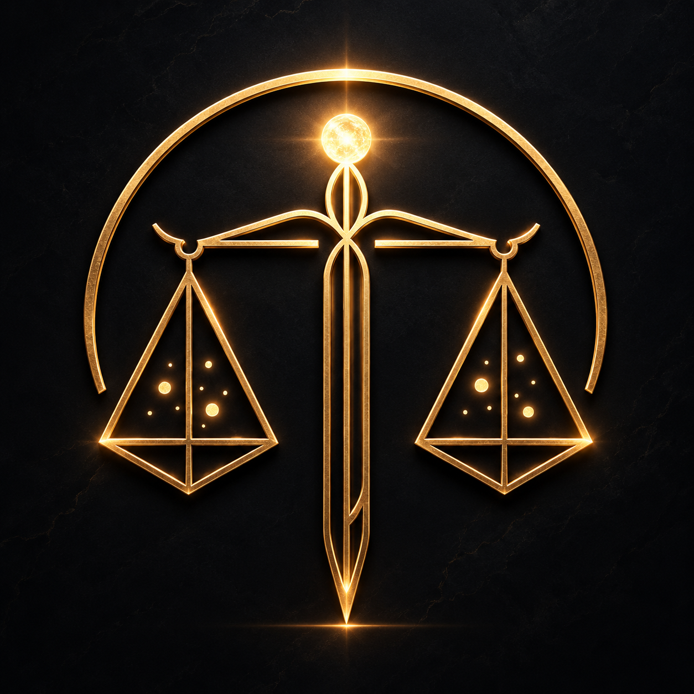
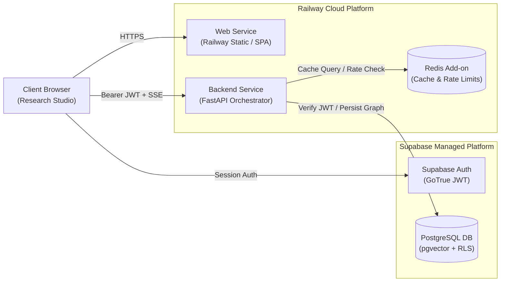

<div align="center">



# THOTH · THE DIVINE SCRIBE
### Autonomous Multi-Agent Academic Intelligence & Epistemic Synthesis Studio

[](https://www.python.org/downloads/)
[](https://fastapi.tiangolo.com)
[](https://railway.app)
[](https://supabase.com)
[](https://redis.io)
[](tests/)

**Thoth** is an autonomous multi-agent academic research intelligence engine. It combines recursive scholarly retrieval (ArXiv, Semantic Scholar, Tavily), dual-key claim-evidence provenance verification, 10 epistemic philosopher reasoning desks, a persistent knowledge vault graph, and an interactive celestial research studio.

<br/>


</div>

---

## ⚡ Quickstart (5 Commands Max)

```bash
git clone https://github.com/shayanazmi/Thoth.git && cd Thoth
python3 -m venv venv && source venv/bin/activate
pip install -r backend/requirements.txt
cp .env.example .env  # Add your NVIDIA_API_KEY and TAVILY_API_KEY
python -m uvicorn web_server:app --port 8000
```
Open **`http://localhost:8000`** in your browser to launch the studio.

---

## 🏛️ System Architecture



---

## 📚 Documentation Index

All technical, operational, and architectural documentation is maintained in [`docs/`](docs/):

- 🏛️ **[System Architecture](docs/architecture.md):** In-depth component breakdown, multi-agent pipeline, and data contracts.
- 🛠️ **[Local Setup & Development](docs/setup.md):** Local setup, venv configuration, Supabase, Redis, and testing.
- 🔑 **[Environment Variables](docs/env-vars.md):** Full configuration matrix, defaults, and secret rules.
- 🔐 **[Authentication Flow](docs/auth-flow.md):** Supabase GoTrue Auth, client session handling, and backend JWT validation.
- 🗄️ **[Database Schema & Migration](docs/database-schema.md):** PostgreSQL DDL, `pgvector` indexing, and Row Level Security (RLS).
- ⚡ **[Caching & Rate Limiting](docs/caching.md):** Redis key namespaces, TTL policies, and fail-open in-memory fallback.
- 🚀 **[Railway Deployment Guide](docs/deployment.md):** Multi-service Railway configuration, containerfiles, and networking.
- 🛡️ **[API Limit & Vendor Resilience](docs/api-limits.md):** Token bucket limits, backoff strategies, and 3-tier LLM failover.
- 📖 **[Operations Runbook](docs/runbook.md):** Health endpoints (`/health`, `/ready`), incident response, and diagnostics.
- 📑 **[Architecture Decision Records](docs/decisions/):** ADR-001 (Monorepo), ADR-002 (Supabase), ADR-003 (Redis), ADR-004 (Decoupled Web).

---

## 🧩 The 10 Epistemic Frameworks

Thoth incorporates 10 classical and scientific frameworks into its critique and sparring tribunal:

| Thinker | Core Epistemic Angle | Operational Role in Thoth |
| :--- | :--- | :--- |
| **Aristotle** | Deductive Certainty | Formal categorical taxonomy & syllogistic validation |
| **Bacon** | Inductive Empiricism | Systematic elimination of preconceptions & idols |
| **Descartes** | Foundational Doubt | Radical methodological skepticism & decomposition |
| **Hume** | Empiricist Skepticism | Rigorous challenge to inductive inference & correlation |
| **Darwin** | Evolutionary Selection | Competitive variation & hypothesis fitness testing |
| **Popper** | Critical Falsification | Aggressive search for counterexamples & disproof |
| **Kuhn** | Paradigm Dynamics | Detection of scientific anomalies & framework limits |
| **Simon** | Bounded Rationality | Computational constraint audit & heuristic satisficing |
| **Turing** | Computability | Operational state-machine testing & algorithmicity |
| **Box** | Pragmatic Fallibilism | Model usefulness verification ("All models are wrong...") |

---

## 🧪 Testing & Verification

```bash
# Run unit & schema tests
pytest tests/test_schemas.py tests/test_pure_functions.py -v

# Run 7-layer system diagnostic
python scripts/dev/diagnostic_test.py
```

---

## 📜 License
Released under the [MIT License](LICENSE).
