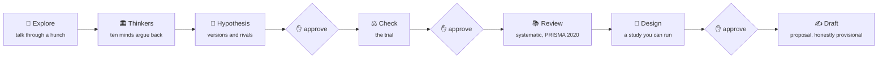

<div align="center">


# Thoth

### A research companion

**Find the question worth asking. Weigh it against what is known. Write only what holds.**

[](https://github.com/shayanazmi/Thoth/actions/workflows/ci.yml)


[](LICENSE)

<a href="docs/media/thoth-reel.mp4">
  
</a>

**[▶ Watch the 18-second reel with sound](docs/media/thoth-reel.mp4)**

*Developed by **Shayan Azmi***

</div>

---

## Why Thoth

Most AI research tools wait for a well-formed question, then find papers that seem to answer it, and too
often they agree with you, invent a citation, or call your idea "novel" because they could not find anything
else. Thoth starts earlier and stays honest:

- You begin with a **hunch**, an observation, or just a conversation. You don't need a formal research question.
- **Ten historical thinkers** argue with your idea, each in their own voice, and none of them gets a veto.
- Your hypothesis goes on **trial** before a neutral court. Papers are witnesses, and the ruling can go
  against you.
- A **systematic review** records every search and every screening decision, and draws its PRISMA counts
  only from that record.
- The **study design** fits the time, people and skills you actually have.
- The **proposal** stays *provisional* until its gaps are closed, and says what they are.

Nothing costly runs, and nothing is exported, until you approve it. An abstract is never passed off as the
full paper.

## The journey

One conversation and one living research file, along a single path you can walk back and forth.



| Stage | What happens |
|---|---|
| **Explore** | Thoth replies like a colleague: a short answer and one sharpening question. General-knowledge claims are marked *unchecked*, with a one-click check against the literature. |
| **Thinkers** | A council of ten gives independent first reactions. They can debate, review your hypothesis, or talk with you one to one, and they remember the project. |
| **Hypothesis** | One working hypothesis, every edit kept as a version with the reason it changed. Strength markers show what is named, directional, scoped and falsifiable. Rivals wait alongside. |
| **Check** | The trial. Your hypothesis is split into claims, papers are read neutrally and appraised for their design, and a judge weighs the case for and against. Five possible rulings, from *contradicted* to *already established*, and the ruling says how much was read in full. |
| **Review** | A PRISMA 2020 systematic review: a protocol you approve, a budget, Auto or Human-in-the-loop screening, citation following, recorded stopping rules, and every count drawn from a recorded decision. |
| **Design** | Candidate study designs built from your real resources, each with what it can and cannot conclude. |
| **Draft** | A research proposal written section by section from your evidence, checked claim by claim by a Verifier, read by a peer Reviewer, and reviewed by the thinkers. Export asks first and watermarks a provisional draft. |

More in [docs/FEATURES.md](docs/FEATURES.md).

## Quick start

You need **Python 3.10+**. For real runs you also need a free NVIDIA NIM key.

```bash
git clone https://github.com/shayanazmi/Thoth.git
cd Thoth
make setup          # creates .venv, installs requirements, creates .env
make dev            # open http://localhost:8000
```

Add your key to `.env`:

| Key | Needed for |
|---|---|
| `NVIDIA_API_KEY` | **Required for real runs.** All models run on free NVIDIA NIM ([build.nvidia.com](https://build.nvidia.com)) |
| `GROQ_API_KEY`, `OPENAI_API_KEY` | Optional fallback models |
| `OPENALEX_API_KEY`, `SEMANTIC_SCHOLAR_API_KEY` | Optional: higher literature-search limits (anonymous access works) |

Without keys, Thoth still starts. The guided demo works fully, and live model calls say plainly that no model
could be reached.

**With Docker:**

```bash
cp .env.example .env    # add NVIDIA_API_KEY
make docker             # http://localhost:8000
```

**Without make:**

```bash
python3 -m venv .venv && . .venv/bin/activate
pip install -r backend/requirements.txt
cp .env.example .env
uvicorn backend.main:app --port 8000
```

### Try the demo

On the home screen, **Try the demo** replays a real recorded run of the whole journey in about three minutes,
with a badge on screen the whole time saying it is a replay. Nothing in it is staged or hand-written.

| Link | What it does |
|---|---|
| `/?demo&branch=nurses&reel=showcase&autoplay` | The presented cut: hunch, thinkers, ruling, honest draft (about 3 minutes) |
| `/?demo` | The hunch picker |
| `/?demo&branch=nurses&chapter=5` | Jump to a chapter (0–9) |
| `/?demo&live` | Live mode against your own backend: it explains each step and never clicks for you |

See [frontend/scripted/README.md](frontend/scripted/README.md).

## Project structure

```
Thoth/
├── docs/                 vision, features, architecture, thinkers, API, media
│   ├── VISION.md         the product vision (from vision/THOTH.docx)
│   ├── FEATURES.md       what Thoth does, stage by stage
│   ├── ARCHITECTURE.md   how it fits together
│   ├── THINKERS.md       the ten thinkers and why they were chosen
│   └── API.md            every endpoint
├── backend/              FastAPI app, research agents, tests
├── frontend/             vanilla ES modules and CSS; the optional guided demo in scripted/
├── server/               Dockerfile, docker-compose, Railway config, health check
├── database/             schema.sql (SQLite); your thoth.db is created here
├── .github/              CI, issue and pull-request templates
├── Makefile              setup · dev · test · docker · health
└── .env.example          every setting, with notes
```

| Read | For |
|---|---|
| [docs/VISION.md](docs/VISION.md) | Why Thoth exists and the guardrails it keeps |
| [docs/FEATURES.md](docs/FEATURES.md) | Every stage in detail |
| [docs/ARCHITECTURE.md](docs/ARCHITECTURE.md) | Request flow, agents, storage, tests |
| [docs/THINKERS.md](docs/THINKERS.md) | The roster, its criteria and its limits |
| [docs/API.md](docs/API.md) | The HTTP API (also live at `/docs`) |
| [server/README.md](server/README.md) | Running and deploying |
| [database/README.md](database/README.md) | The schema, backups and resets |
| [CONTRIBUTING.md](CONTRIBUTING.md) | How to contribute |

## Integrity, by design

These rules are enforced in code, not just stated as goals:

- **No fabrication.** Citations, counts, source access, methods, results and originality are never invented.
  References are built only from the papers actually cited.
- **Honest reading depth.** Every paper is labelled *full text* or *abstract only*, and that label is never
  upgraded.
- **Never falsely complete.** While evidence or review is open, work is **provisional**, with the gaps listed.
  Verifier findings soften or flag claims; they never silently delete them.
- **No manufactured originality.** "Likely novel" is allowed only when the adjacent-field and citation checks
  ran and found no overlap. Gaps must be revealed by specific papers.
- **You decide.** Approval flags are the only way into the trial, the review and the writing. Nothing is
  exported without your approval.
- **Conversation first.** The chat never blocks while work runs.

## Behind the reel

The reel at the top was cut from a **real recorded run**, with nothing staged. The hunch was *"Why do people
trust a confident wrong answer over a hesitant right one?"*. Hume and Popper's lines are their actual replies
in that run. The trial found 15 papers, 4 with open full text and 11 abstract-only, and labelled them that
way. Of the 8 papers analysed, every claim came back *not addressed*, and Thoth said so instead of writing
"studies show…". The recording lives in [`frontend/scripted/fixtures/trust/`](frontend/scripted/fixtures/trust/).

## Testing

```bash
make test        # the scenario suite, offline: no keys, no network
make test-live   # also the live-model test (uses your keys)
```

Each scenario test in `backend/tests/scenarios/` is tied to a section of the vision and written as what a user
would see.

## Credits

**Developed by Shayan Azmi.**

The vision, design and implementation of Thoth are by Shayan Azmi. Thinker dossiers draw on the published
works of the thinkers and the scholarship about them (see each dossier's sources). Literature comes from
[OpenAlex](https://openalex.org), [Europe PMC](https://europepmc.org) and
[Semantic Scholar](https://www.semanticscholar.org); models run on [NVIDIA NIM](https://build.nvidia.com).
Appraisal checklists are adapted from Cochrane RoB 2 and the JBI critical appraisal tools.

If you use Thoth in your work, please cite it (see [CITATION.cff](CITATION.cff)).

## License

[MIT](LICENSE) © 2026 Shayan Azmi

---

<div align="center">

> *Thoth should not merely answer questions a researcher already knows how to ask. It should help people
> discover which questions are worth asking, understand what existing scholarship establishes, and
> investigate what might meaningfully add to that knowledge.*
>
> — from the Thoth vision, [docs/VISION.md](docs/VISION.md)

</div>
