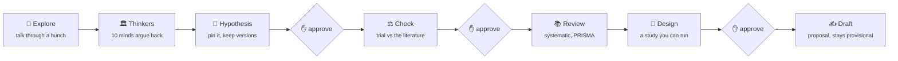
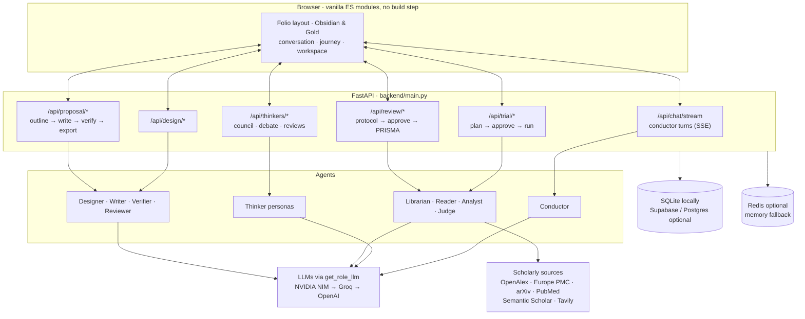

<div align="center">


# Thoth

**A research companion that helps you find the question worth asking, and records honestly what the evidence shows.**


<a href="docs/media/thoth-reel.mp4">
  
</a>

**[▶ Watch the 18-second reel with sound](docs/media/thoth-reel.mp4)**

</div>

---

## The idea

Most AI research tools wait for a well-formed question, then retrieve papers that seem to answer it. Thoth
starts earlier. From the spec, [`THOTH/THOTH.docx`](THOTH/THOTH.docx):

> Thoth should not merely answer questions a researcher already knows how to ask. It should help people
> discover which questions are worth asking, understand what existing scholarship establishes, and
> investigate what might meaningfully add to that knowledge.

You open Thoth with a hunch, an observation, or just a conversation. Thoth helps you turn it into a defensible
contribution, and it never claims more than the evidence supports.

Thoth plays three roles at once:

| Role | What it does for you |
|---|---|
| **Conversational companion** | Talks your hunch through like a colleague. You don't need a formal research prompt. |
| **Rigorous investigator** | Finds, reads and weighs the literature. It surfaces contradictions and checks whether your idea is actually new. |
| **Research-development partner** | Helps you refine the hypothesis, design a study you can actually run, and draft a proposal, without inventing results. |

## The journey

One conversation and one living research file, along a single path. Every costly step shows its plan and cost
first and **runs only when you approve it**.



| Step | What happens |
|---|---|
| **Explore** | The conductor replies like a colleague. It marks general-knowledge claims as *unchecked* and proposes notebook entries. It can offer heavier work but never starts it. |
| **Thinkers** | A council of ten historical thinkers gives independent first takes. They can also debate, review blind, or talk to you one to one. |
| **Hypothesis** | You pin one hypothesis. Every edit is kept as a version, and rival hypotheses sit alongside it. |
| **Check (the trial)** | The hypothesis is split into sub-claims and each paper is treated as a witness. The papers fill an evidence matrix, and a neutral judge rules. The ruling says how many papers were read in full. |
| **Review** | A systematic review: protocol, then approval, then search and screening. PRISMA counts come only from recorded decisions. |
| **Design** | Candidate study designs built from the time, people, budget and skills you actually have. |
| **Draft** | Outline, then approval, then writing, followed by a Verifier pass and a Reviewer pass. The draft stays **provisional** until its gaps are closed. Export asks first and watermarks a provisional draft. |

## The thinkers

Ten personas, each built from a dossier of their actual method. They criticise severely, and none of them gets a veto.

| Thinker | What they bring |
|---|---|
| **Aristotle** | What is the thing? Definitions, kinds, and four kinds of explanation. |
| **Ibn al-Haytham** | Doubt towards authorities; checking claims by controlled, repeatable test. |
| **David Hume** | What do we actually observe, and what are we adding? Causation and evidence. |
| **Charles Darwin** | Patient accumulation, variation, mechanism, and the facts against your own view. |
| **Florence Nightingale** | Numbers as moral instruments: compare like with like, then change things. |
| **Max Weber** | What the action means to the people doing it; ideal types; many causes. |
| **Karl Popper** | What would show you wrong? Bold conjectures and severe tests. |
| **Thomas Kuhn** | Which framework are you inside, and what does it stop you seeing? |
| **Herbert Simon** | Real people decide with limited information; design for how things actually work. |
| **Elinor Ostrom** | Field evidence against tidy models; the rules people build for themselves. |

They are AI personas, not the people themselves. Dossiers live in
[`backend/thinkers/dossiers/`](backend/thinkers/dossiers/).

## Integrity, by design

These aren't aspirations. The code enforces them:

- **No fabrication.** Citations, counts, source access, methods, results and originality are never invented.
  A citation's locator must point inside the passage its claim depends on, and the check fails closed.
- **Honest reading depth.** An abstract is never passed off as the full paper, and `extraction_quality` is
  never upgraded.
- **Never falsely complete.** When evidence or review is still open, work is labelled **provisional**, with the
  gaps listed. Truth Guard and Verifier findings downgrade status; they never silently delete claims.
- **No manufactured originality.** An idea is never declared original just because a model said so.
- **You hold the keys.** The approve flags on the trial, review and proposal are the only way into expensive
  compute. There are no test-only bypasses, and nothing is exported without your approval.
- **Conversation first.** The chat never blocks while work runs.

## Behind the reel

The reel at the top was cut from a **real recorded run**, with nothing staged. The hunch was *"Why do people trust a
confident wrong answer over a hesitant right one?"*.

- Hume and Popper's lines are their actual replies in that run.
- The trial found **15 papers**: 4 had open full text and 11 were abstract-only, and Thoth labelled them that way.
- Of the **8 papers analysed**, every sub-claim came back *not addressed*. Thoth said so instead of writing
  "studies show…".

The recording is in [`frontend/scripted/fixtures/trust/`](frontend/scripted/fixtures/trust/). The reel was built
with the `brag` Claude Code plugin from Thoth's own UI tokens, fonts and assets, and has an original phonk score.

## Architecture



- **Streaming:** long work streams over SSE as `data: {"event": …, "payload": …}`, so the chat stays usable while it runs.
- **Fail open:** Postgres/Supabase and Redis are optional. `/ready` reports `sqlite_local` / `memory_fallback`
  when they're absent.
- **Provider fallback:** every model call goes through `get_role_llm` / `FallbackLLMWrapper`, with NVIDIA NIM
  first and Groq and OpenAI as fallbacks. Fallback output is labelled.

## Quick start

```bash
git clone https://github.com/shayanazmi/Thoth.git
cd Thoth
make setup     # venv + backend/requirements.txt + .env from .env.example
make dev       # uvicorn on http://localhost:8000 (serves the UI at /)
```

The app boots with no keys at all, and model calls degrade gracefully. For a real run, add these to `.env`:

| Key | Needed for |
|---|---|
| `NVIDIA_API_KEY` | **Required.** Primary models (NVIDIA NIM) |
| `TAVILY_API_KEY` | **Required.** Web and scholarly search |
| `GROQ_API_KEY`, `OPENAI_API_KEY` | Optional fallback models |
| `SEMANTIC_SCHOLAR_API_KEY` | Optional: higher Semantic Scholar rate limits |
| `SUPABASE_*`, `REDIS_URL` | Optional: hosted storage and cache |

> **venv gotcha:** the committed `venv/` was made on macOS. If its Python symlink is dangling, delete it and run
> `make setup`, or point make at another venv: `VENV=/path make dev`.

### Try the demo

On the landing page, **Try the demo** replays a recorded real run of the whole journey in about three minutes.
A badge stays on screen the whole time to say it's a replay. Developer links:

| URL | What it does |
|---|---|
| `/?demo` | Opens the hunch picker after the intro |
| `/?demo&branch=nurses&chapter=5` | Jumps straight to a chapter (0–9) |
| `/?demo&reel=trial` | A short reel: `gate`, `thinkers`, `trial`, `draft` or `howto` |
| `/?demo&autoplay&clean` | A clean film for screen recording |
| `/?demo&live` | Live mode against your own backend. It explains each step and never clicks for you |

How to record a new hunch: [`frontend/scripted/README.md`](frontend/scripted/README.md).

## Commands

| Command | What it does |
|---|---|
| `make setup` | Creates the venv, installs dependencies, and copies `.env` from `.env.example` |
| `make dev` | Runs the backend and UI on `:8000` |
| `make test-vision` | Runs the test gate (`backend/tests/scenarios`); `make test` is an alias |
| `make migrate` / `make seed` | Database migrations and seed data |
| `make health` | Health check |
| `make cache-flush` | Flushes the cache |
| `make help` | Lists everything |

## Testing

```bash
make test-vision     # 72 passed, 1 skipped
```

The gate is a set of scenario tests in `backend/tests/scenarios/`. Each test gets its own temporary database,
and provider keys are blanked so tests never call live services. The one skipped test is a live-model test; set
`THOTH_LIVE_TESTS=1` to run it.

Tests are a debugging aid, not proof. A feature counts as done only when its walkthrough in
[`docs/archive/verify/`](docs/archive/verify/) records a real run in the browser.

## Project structure

```
thoth/
├── THOTH/THOTH.docx        the spec (the only trusted document)
├── CLAUDE.md               working context: state, folder map, rules
├── backend/
│   ├── main.py             FastAPI app, routers, static mounts
│   ├── agents.py           LLM factory + provider fallback
│   ├── api/                chat · thinkers · trial · review · design · proposal · workspace · health
│   ├── conversation/       conductor, idea promotion, task lifecycle
│   ├── thinkers/           roster, personas, modes, dossiers/
│   ├── research/           librarian · reader · analyst · judge · review · designer · writer · verifier
│   ├── intellectual_rigour/  Truth Guard and rigour checks
│   ├── memory/             SQLite schema, conversation store, vault, graph
│   └── tests/scenarios/    the test gate
├── frontend/
│   ├── index.html          shell: sidebar · journey · conversation · workspace · intro
│   ├── js/  styles/        vanilla modules; Obsidian & Gold tokens
│   ├── scripted/           the optional guided demo + recorded runs
│   └── assets/             bust, scales, logo
├── db/migrations/          Postgres migrations (kept in step with backend/memory/db.py)
└── docs/                   status, feature specs, walkthroughs, ops reference, media
```

## Documentation

| Where | What |
|---|---|
| [`THOTH/THOTH.docx`](THOTH/THOTH.docx) | The product vision and functional requirements |
| [`CLAUDE.md`](CLAUDE.md) | Working context: current state, folder map, rules |
| [`docs/SYSTEM_STATE.md`](docs/SYSTEM_STATE.md) | What's built, the gate, and the open gaps |
| [`docs/features/`](docs/features/README.md) | The redesign specs, one per feature, including every agent prompt |
| [`docs/archive/verify/`](docs/archive/verify/) | User-seat walkthroughs: the evidence each feature works |
| [`docs/decisions/`](docs/decisions/) | Architecture decision records |
| [`docs/setup.md`](docs/setup.md), [`deployment.md`](docs/deployment.md), [`runbook.md`](docs/runbook.md) | Ops reference (written before the redesign; check against the code) |

## Status

Every step of the journey is built, and each has a recorded walkthrough. Known gaps, tracked in
[`docs/SYSTEM_STATE.md`](docs/SYSTEM_STATE.md):

- On the free tier, analysis runs at about **one paper per minute**, so a 15-paper trial takes 8–10 minutes.
- Fallback-model output is labelled but not yet weighted lower.
- Thinker replies aren't yet in the conductor's server-side memory.
- Reviews can't yet be revised and re-screened.
- Vault notes are global, not yet project-scoped.
- There are no frontend tests.

## Author

Built by **Shayan Azmi**, who builds at [github.com/shayanazmi](https://github.com/shayanazmi) and takes photos at
[@letsclicksomephotos](https://www.instagram.com/letsclicksomephotos/).

There's no license file yet, so until one is added the code is not licensed for reuse.
