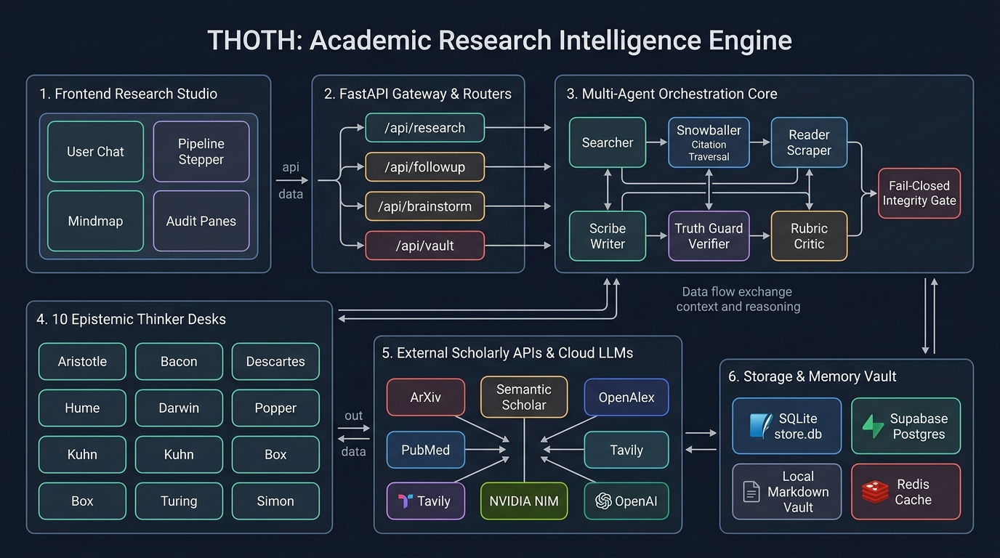
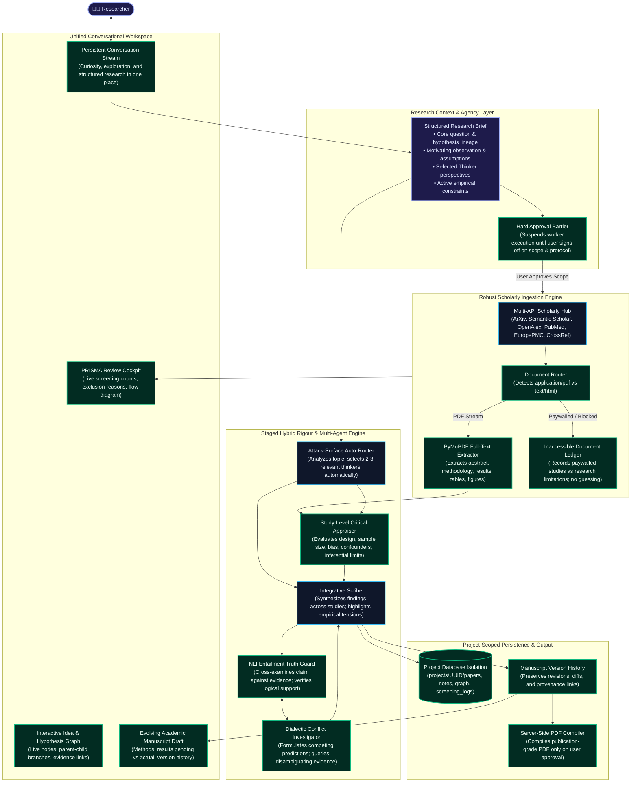

# THOTH: Comprehensive Codebase & Product-Vision Alignment Audit
**A Ground-Truth Engineering Evaluation of Current System Reality vs. Target Product Vision**

- **Document Version:** 1.0.0 (Definitive Technical Audit)
- **Target Baseline:** `THOTH.docx` — *THOTH: Product Vision & Functional Requirements* (v1.0, 15 Oct 2026)
- **Inspected Repository:** `/Users/shayanazmi/college/project based learning /langchain/thoth`
- **Execution Policy:** Non-destructive, read-only static analysis and runtime tracing.

---

## Table of Contents
1. [Executive Summary & System Reality](#1-executive-summary--system-reality)
2. [Visual Architecture Guide (Zero-Knowledge Onboarding)](#2-visual-architecture-guide-zero-knowledge-onboarding)
   - [2.1 The Big Picture: How Thoth Operates](#21-the-big-picture-how-thoth-operates)
   - [2.2 Current System Reality: Disconnects, Traps & Information Loss](#22-current-system-reality-disconnects-traps--information-loss)
   - [2.3 Target State Architecture: The Unified Research Companion](#23-target-state-architecture-the-unified-research-companion)
   - [2.4 Subsystem Dictionary & Responsibilities](#24-subsystem-dictionary--responsibilities)
3. [Repository Baseline & Workspace Anomaly Audit](#3-repository-baseline--workspace-anomaly-audit)
4. [Product Vision Distillation: 33 Testable Requirements](#4-product-vision-distillation-33-testable-requirements)
5. [Product-to-Code Traceability Matrix](#5-product-to-code-traceability-matrix)
6. [Deep-Dive Capability Technical Findings](#6-deep-dive-capability-technical-findings)
   - [6.1 Conversational Intellect & Mode Fragmentation](#61-conversational-intellect--mode-fragmentation)
   - [6.2 The Unenforced Research Approval Gate](#62-the-unenforced-research-approval-gate)
   - [6.3 Idea Capture, Idea Networks & Hypothesis Branching](#63-idea-capture-idea-networks--hypothesis-branching)
   - [6.4 The "PDF-as-HTML" Ingestion Hazard & Truncation Cascade](#64-the-pdf-as-html-ingestion-hazard--truncation-cascade)
   - [6.5 Originality Assessment vs. Hallucinated "Knowledge Gaps"](#65-originality-assessment-vs-hallucinated-knowledge-gaps)
   - [6.6 Systematic Reviews & Total PRISMA Absence](#66-systematic-reviews--total-prisma-absence)
   - [6.7 Study-Level Appraisal vs. Report Rubric Grading](#67-study-level-appraisal-vs-report-rubric-grading)
   - [6.8 The 10 Epistemic Thinkers & Their Pipeline Severance](#68-the-10-epistemic-thinkers--their-pipeline-severance)
   - [6.9 Truth Guard Lexical Matching vs. Evidential Entailment](#69-truth-guard-lexical-matching-vs-evidential-entailment)
   - [6.10 Disagreements, Severity Gating & Circular Replan Loop](#610-disagreements-severity-gating--circular-replan-loop)
   - [6.11 Academic Manuscript Evolution & In-Place Destruction](#611-academic-manuscript-evolution--in-place-destruction)
   - [6.12 The Presentational PDF Export (`window.print()`)](#612-the-presentational-pdf-export-windowprint)
   - [6.13 Storage Architecture, Global Namespace Pollution & Privacy](#613-storage-architecture-global-namespace-pollution--privacy)
   - [6.14 Dispatcher, Circuit Breakers, Fallbacks & Telemetry](#614-dispatcher-circuit-breakers-fallbacks--telemetry)
7. [Systemic Root Cause Analysis](#7-systemic-root-cause-analysis)
8. [Phased Technical Implementation Roadmap](#8-phased-technical-implementation-roadmap)
9. [Proposed Acceptance Test Suite & Evaluation Framework](#9-proposed-acceptance-test-suite--evaluation-framework)
10. [Open Strategic Questions Requiring Owner Clarification](#10-open-strategic-questions-requiring-owner-clarification)
11. [Quality Gate: Definitive Answers to the Five Core Questions](#11-quality-gate-definitive-answers-to-the-five-core-questions)

---

## 1. Executive Summary & System Reality

Thoth is conceived in **`THOTH.docx`** as an open-source, evidence-led **research companion**. Its mission is not merely to answer prompts or generate generic literature summaries, but to help a researcher discover questions worth asking, dialectically explore ideas, build defensible knowledge, appraise empirical evidence at the study level, navigate intellectual tensions via classical epistemological frameworks, and develop an evolving academic manuscript draft.

### System Reality vs. Product Intent

| Dimension | System Reality Today | Intended Product Vision (`THOTH.docx`) |
|:---|:---|:---|
| **Primary Identity** | Automated academic search & 5-section Markdown summarizer | Interactive intellectual companion for curiosity, ideation & discovery |
| **User Interaction** | Fragmented UI modes (`Fast Chat`, `Deep Research`, `Brainstorm`) | Single, unified conversational workspace that deepens organically |
| **Research Agency** | Clarification card renders, but pipeline runs in background immediately | Strict user approval gate before literature review or deep compute launches |
| **Idea & Hypotheses** | Ephemeral chat strings; overwritten on subsequent turns | Persistent Idea Network with typed relations, branching & evidence lineage |
| **Paper Reading** | Raw HTTP GET parsed with BeautifulSoup; truncated to 3,000 chars | Full-text PDF section extraction (methods, results, figures, tables) |
| **Originality** | Writer LLM invents "Knowledge Gaps" out of thin air | Prior-art search across alternative terms, adjacent fields & methods |
| **Literature Review** | Ad-hoc top-N search; no screening records; zero PRISMA tracking | PRISMA-aligned review with explicit protocol, criteria, screening logs & flowchart |
| **Quality Appraisal** | LLM-as-judge scores drafted report text out of 10 | Critical appraisal of underlying studies (design, sample, bias, confounders) |
| **10 Epistemic Thinkers** | Completely disconnected from pipeline; triggered only via `/slash` commands | Integrated across brainstorming, review, hypothesis testing & synthesis |
| **Provenance & Truth** | Lexical string check: matches verbatim quote in 1,500-char snippet | Evidential entailment checking; distinguishes quotes from logical support |
| **Manuscript Output** | Single 5-section Markdown report; in-place overwriting | Evolving academic draft with proposed methods, pending vs actual results |
| **PDF Generation** | Native browser print dialog (`window.print()`) | Server-side, styled academic PDF compiler with user approval gate |
| **Storage & Privacy** | Global singleton SQLite/Vault; all sessions share one directory | Project-scoped paper retention, granular cleanup & explicit data boundaries |

---

## 2. Visual Architecture Guide (Zero-Knowledge Onboarding)

*This visual guide provides a standalone conceptual understanding of how Thoth operates. Anyone without prior knowledge of the codebase can read these diagrams and understand how data moves, where the bottlenecks lie, and how the target system will work.*

### 2.1 The Big Picture: How Thoth Operates



```mermaid
flowchart TD
    classDef client fill:#1e293b,stroke:#38bdf8,stroke-width:2px,color:#f8fafc;
    classDef gateway fill:#1e1b4b,stroke:#818cf8,stroke-width:2px,color:#f8fafc;
    classDef orch fill:#064e3b,stroke:#34d399,stroke-width:2px,color:#f8fafc;
    classDef external fill:#451a03,stroke:#fb923c,stroke-width:2px,color:#f8fafc;
    classDef storage fill:#312e81,stroke:#a78bfa,stroke-width:2px,color:#f8fafc;

    User(["🧑‍🔬 Researcher / Student / Scholar"]):::client

    subgraph UI ["1. Frontend Research Studio (Single Page Web App)"]
        Landing["Landing View<br/>(Hero prompt, preset topic chips)"]:::client
        ChatWorkspace["Active Research Studio<br/>(Chat feed, pipeline stepper, markdown report)"]:::client
        ArtifactPanes["Artifact Inspection Panes<br/>(Scales of Ma'at Audit, Concept Mindmap, Source Cards)"]:::client
        ThinkerModal["Brainstorming & Thinker Drawer<br/>(Socratic sparring with 10 philosophers)"]:::client
    end

    subgraph BackendGateway ["2. FastAPI Gateway & Intent Routers"]
        AuthMid["Auth Middleware<br/>(Optional Supabase Bearer JWT)"]:::gateway
        RouterResearch["/api/research/stream<br/>(Full multi-agent pipeline stream)"]:::gateway
        RouterFollowup["/api/followup/stream<br/>(Fast chat, local QA, web probe, report patch)"]:::gateway
        RouterBrainstorm["/api/brainstorm<br/>(Thinker matching & Socratic sparring)"]:::gateway
        RouterVault["/api/vault & /api/sessions<br/>(Graph export, notes retrieval, session history)"]:::gateway
    end

    subgraph MultiAgentEngine ["3. Multi-Agent Research Orchestrator"]
        ClarifyGate["Mandate & Clarification Gate<br/>(Synthesizes topic & broad keyword check)"]:::orch
        SearchAgent["Searcher Node<br/>(Queries ArXiv, S2, OpenAlex, PubMed, Tavily)"]:::orch
        SnowballAgent["Snowballer Node<br/>(Traverses paper citation networks)"]:::orch
        ScraperAgent["Reader / Scraper Node<br/>(Fetches URLs via requests & BeautifulSoup)"]:::orch
        WriterAgent["Scribe / Writer Node<br/>(Synthesizes 5-section Markdown report)"]:::orch
        VerifierAgent["Truth Guard / Verifier Node<br/>(Audits atomic claims against source quotes)"]:::orch
        CriticAgent["LLM-as-a-Judge Critic Node<br/>(Scores report on 5 writing rubrics /10)"]:::orch
        GateEngine["Research Integrity Gate<br/>(Fail-closed retry loop: max 2 revisions)"]:::orch
        MindmapAgent["Mind Map Generator<br/>(Extracts JSON concept graph)"]:::orch
        FollowupAgent["Strategic Editor<br/>(Generates 3 proactive next-step questions)"]:::orch
    end

    subgraph ThinkerDesks ["4. 10 Epistemic Thinker Desks (Socratic Philosophers)"]
        Desks["Aristotle, Bacon, Descartes, Hume, Darwin,<br/>Popper, Kuhn, Box, Turing, Simon"]:::orch
    end

    subgraph ExternalWorld ["5. External Scholarly APIs & Cloud Models"]
        NvidiaLLM["NVIDIA NIM Cloud<br/>(Nemotron 30B / Llama 3.1)"]:::external
        FallbackLLM["Groq / OpenAI Fallback<br/>(GPT-4o, OSS-120B)"]:::external
        ScholarAPIs["Academic Databases<br/>(ArXiv, Semantic Scholar, OpenAlex, PubMed, Tavily)"]:::external
    end

    subgraph StorageVault ["6. Knowledge Storage & Persistence"]
        LocalDB[("SQLite store.db / Supabase Postgres<br/>(Sessions, Reports, Notes, Edges)")]:::storage
        VaultFiles["Local Markdown Vault<br/>(vault/sources/*.md, vault/topics/*.md)")]:::storage
        RedisCache[("Redis Cache & Rate Limits<br/>(24h HTTP cache & token bucket throttle)")]:::storage
    end

    User -->|Type topic or query| UI
    Landing -->|Submit| RouterResearch
    ChatWorkspace -->|Follow-up message| RouterFollowup
    ThinkerModal -->|Brainstorm sparring| RouterBrainstorm
    ArtifactPanes -->|Fetch note / graph| RouterVault

    RouterResearch --> ClarifyGate --> SearchAgent
    SearchAgent -->|HTTP Queries| ScholarAPIs
    SearchAgent --> SnowballAgent --> ScraperAgent
    ScraperAgent --> WriterAgent
    WriterAgent --> VerifierAgent & CriticAgent
    VerifierAgent & CriticAgent --> GateEngine
    GateEngine -->|If Failed (Attempt <= 2)| WriterAgent
    GateEngine -->|If Passed or Retries Maxed| MindmapAgent & FollowupAgent
    MindmapAgent & FollowupAgent --> StorageVault
    StorageVault --> LocalDB & VaultFiles

    RouterBrainstorm --> Desks
    Desks -.->|Disconnected from Main Pipeline| RouterBrainstorm

    MultiAgentEngine -->|Inference Calls| NvidiaLLM
    NvidiaLLM -.->|On Error Failover| FallbackLLM
    BackendGateway -->|Cache lookup| RedisCache
```

---

### 2.2 Current System Reality: Disconnects, Traps & Information Loss

*This diagram details the four critical points where the current implementation breaks down or loses information.*

```mermaid
flowchart TD
    classDef flaw fill:#450a0a,stroke:#ef4444,stroke-width:2px,color:#fee2e2;
    classDef disconnect fill:#701a75,stroke:#f472b6,stroke-width:2px,color:#fdf2f8;
    classDef normal fill:#0f172a,stroke:#64748b,stroke-width:1px,color:#f8fafc;

    subgraph Flaw1 ["Hazard 1: The 'PDF-as-HTML' Ingestion Trap"]
        ArxivURL["ArXiv API returns PDF URL<br/>(e.g., https://arxiv.org/pdf/2401.12345v1)"]:::normal
        BS4Scrape["tools.py: scrape_url()<br/>requests.get() downloads binary bytes into resp.text<br/>BeautifulSoup parses binary PDF stream as HTML!"]:::flaw
        ScrapeTrunc["Text sliced to [:3000] chars<br/>Result: Scrambled ASCII or empty text!"]:::flaw
        AbstractFallback["System silently falls back to 400-char abstract only.<br/>Full methods, results, and data are lost!"]:::flaw
        ArxivURL --> BS4Scrape --> ScrapeTrunc --> AbstractFallback
    end

    subgraph Flaw2 ["Hazard 2: Thinker Desk Pipeline Severance"]
        BrainstormUI["Researcher brainstorms in Brainstorm View<br/>Dialogue forges testable hypothesis"]:::normal
        EscalationBtn["Escalation Proposal Card renders in UI:<br/>'🚀 Launch Deep Research with Popper'"]:::normal
        DropThinker["app.js: launchEscalatedResearch()<br/>Toast logs 'with popper', BUT thinkerId is dropped!<br/>startResearch() payload omits thinker_id entirely!"]:::disconnect
        PipelineBlind["stream_research_pipeline has 0 references to thinkers!<br/>Standard pipeline runs with ZERO thinker input!"]:::disconnect
        BrainstormUI --> EscalationBtn --> DropThinker --> PipelineBlind
    end

    subgraph Flaw3 ["Hazard 3: The Illusory Approval Gate"]
        UserSendsTopic["User submits broad topic: 'Cancer immunotherapy'"]:::normal
        GateFires["routes_research.py: evaluate_clarification_need()<br/>Emits SSE 'clarification_gate' event with option pills"]:::normal
        NoWait["Backend DOES NOT pause execution!<br/>Thread immediately launches background search & scraper!"]:::flaw
        UserIgnored["Frontend UI displays spinner:<br/>'Scribe is initiating broad academic search in parallel...'"]:::flaw
        UserSendsTopic --> GateFires --> NoWait --> UserIgnored
    end

    subgraph Flaw4 ["Hazard 4: Lexical Verifier vs. Entailment"]
        SourceText["Source Text: 'Contrary to claims, LLMs fail causal benchmark X.'"]:::normal
        ReportClaim["Report Assertion: 'Models succeed on causal benchmark X [[src-1]].'"]:::normal
        StringMatch["integrity_gate.py: verify_quote_provenance()<br/>Checks if words 'causal benchmark X' exist in snippet."]:::flaw
        FalsePass["Claim marked DIRECTLY_SUPPORTED!<br/>Opposite conclusion verified because quote was found!"]:::flaw
        SourceText & ReportClaim --> StringMatch --> FalsePass
    end
```



---

### 2.3 Target State Architecture: The Unified Research Companion

*The architectural blueprint for the transformed system, closing all gaps identified in the audit.*



---

### 2.4 Subsystem Dictionary & Responsibilities

| Subsystem | Primary Code Location | Current Functionality | Target State Functionality |
|:---|:---|:---|:---|
| **FastAPI Gateway** | [`backend/main.py`](file:///Users/shayanazmi/college/project%20based%20learning%20/langchain/thoth/backend/main.py), [`backend/api/`](file:///Users/shayanazmi/college/project%20based%20learning%20/langchain/thoth/backend/api) | Routes SSE endpoints; serves static files; CORS middleware | Adds project-scoped routes, async job suspension/resume, streaming protocol logs |
| **Scholarly Discovery** | [`backend/scholarly.py`](file:///Users/shayanazmi/college/project%20based%20learning%20/langchain/thoth/backend/scholarly.py) | Queries 5 APIs + Tavily; citation snowballing | Adds screening candidate ledger, query date logging, search boundary enforcement |
| **Scraper / Reader** | [`backend/tools.py`](file:///Users/shayanazmi/college/project%20based%20learning%20/langchain/thoth/backend/tools.py) | Synchronous `requests.get` + BeautifulSoup; 3,000 char cap | Detects content-type; PyMuPDF for PDFs; section-aware parsing (methods, results) |
| **Orchestrator** | [`backend/orchestrator.py`](file:///Users/shayanazmi/college/project%20based%20learning%20/langchain/thoth/backend/orchestrator.py) | Linear FSM pipeline; parallel Verifier/Critic; fail-closed loop | Staged hybrid flow; integrates selected thinkers; genuine approval barriers |
| **Integrity Gate** | [`backend/intellectual_rigour/integrity_gate.py`](file:///Users/shayanazmi/college/project%20based%20learning%20/langchain/thoth/backend/intellectual_rigour/integrity_gate.py) | Quote substring matching; deterministic bibliography | NLI entailment checking; claim status tracking (Supported, Contradicted, Uncertain) |
| **Thinker Frameworks** | [`backend/intellectual_rigour/frameworks/`](file:///Users/shayanazmi/college/project%20based%20learning%20/langchain/thoth/backend/intellectual_rigour/frameworks) | 10 philosopher prompts; report text review via `/slash` cmd | Automatically routed; inspect primary source evidence; investigate disagreements |
| **Vault & Memory** | [`backend/memory/`](file:///Users/shayanazmi/college/project%20based%20learning%20/langchain/thoth/backend/memory) | Shared SQLite DB (`store.db`) and markdown files (`vault/`) | Project-scoped database records; Idea & Hypothesis graphs; manuscript revisions |
| **Web Frontend** | [`frontend/js/app.js`](file:///Users/shayanazmi/college/project%20based%20learning%20/langchain/thoth/frontend/js/app.js) | Tab-based SPA (Landing, Studio, Sparring); SSE consumer | Unified conversation stream; live idea network graph; PRISMA audit cockpit |

---

## 3. Repository Baseline & Workspace Anomaly Audit

### 3.1 File Tree Structure
```
thoth/
├── .agent/
├── .agents/
├── .env / .env.example
├── .git/
├── Makefile                          # Dev & test targets
├── README.md                         # Public overview & system documentation
├── THOTH/
│   └── THOTH.docx                    # Authoritative Product Vision document
├── backend/
│   ├── __init__.py
│   ├── agents.py                     # LangChain prompts, LLM instances, Fallback wrappers
│   ├── api/                          # FastAPI routers (research, followup, brainstorm, vault)
│   ├── backend -> .../backend        # [ANOMALY] Self-referential recursive symlink!
│   ├── conversation/                 # Escalation, mandate synthesis, clarification gates
│   ├── core/                         # Config, logging, Redis cache, rate limiting, auth
│   ├── dispatcher.py                 # Concurrency limiter, token bucket, circuit breaker
│   ├── intellectual_rigour/          # 10 Thinker desks, matcher, sparring, integrity gate
│   ├── main.py                       # FastAPI ASGI application entrypoint
│   ├── memory/                       # SQLite DB, Markdown Vault, vector index, graph traversal
│   ├── models/                       # Pydantic v2 domain schemas
│   ├── orchestrator.py               # Linear FSM pipeline & async fan-out coordinator
│   ├── pipeline.py                   # Node definitions (search, scrape, writer, verifier, critic)
│   ├── reports/                      # Markdown section parsing and in-place patching
│   ├── repositories/                 # Supabase / SQLite repository abstractions
│   ├── scholarly.py                  # API connectors: ArXiv, S2, OpenAlex, EuropePMC, PubMed
│   ├── telemetry.py                  # Telemetry decorator wrapper
│   ├── tests/                        # 36 unit/integration test suites
│   └── tools.py                      # Tavily search & BeautifulSoup web scraping tools
├── db/
│   ├── migrations/                   # SQL migration files
│   ├── seed/                         # Demo seed data
│   └── store.db                      # Local SQLite database (1.28 MB)
├── docs/                             # Architecture, caching, setup, and runbook docs
├── frontend/
│   ├── index.html                    # Main Single Page App structure
│   ├── js/
│   │   ├── animations.js             # 3D parallax & micro-interactions
│   │   └── app.js                    # Core client state, SSE streaming consumer, UI events
│   ├── styles/                       # CSS design tokens, layouts, responsive rules
│   └── components/                   # Modal dialogs & UI components
├── main.py                           # Root entrypoint redirecting to backend.main:app
├── railway.toml                      # Cloud PaaS deployment configuration
├── requirements.txt / Makefile       # Dependency manifests
└── vault/                            # Global markdown storage: topics/ and sources/
```

### 3.2 Persistent State & Workspace Anomalies

1. **Untracked Symlink Anomaly (`backend/backend`):**
   - In [`backend/main.py:L16-L21`](file:///Users/shayanazmi/college/project%20based%20learning%20/langchain/thoth/backend/main.py#L16-L21), the following code executes at module load:
     ```python
     _backend_symlink = os.path.join(_CURRENT_DIR, "backend")
     if not os.path.exists(_backend_symlink):
       try:
         os.symlink(_CURRENT_DIR, _backend_symlink)
       except Exception:
         pass
```
   - This was added to allow imports when deployed in containers where root directory is `/backend`. However, in a local workspace, it creates a self-referential symlink `backend/backend -> .../backend`. File search tools and linters entering `backend/backend` will cycle into `backend/backend/backend` indefinitely unless symlinks are skipped.
2. **Untracked Directory (`THOTH/`):** Contains the authoritative specification document `THOTH.docx` (52,218 bytes).
3. **Database Artifact (`db/store.db`):** 1.28 MB SQLite file containing test and run data across 7 tables.
4. **Vault Directory (`vault/`):** Contains 6 source markdown notes in `vault/sources/` and 5 topic markdown notes in `vault/topics/`.

---

## 4. Product Vision Distillation: 33 Testable Requirements

Distilled directly from `THOTH.docx` into verifiable functional assertions:

### A. Conversation, Agency & Research Brief
- **CONV-01:** System supports open-ended conversation without demanding a formal research prompt.
- **CONV-02:** System proactively detects promising research directions and explains why they are worth exploring.
- **CONV-03:** System prepares a research question and preliminary plan in the background without blocking conversation.
- **CONV-04:** System presents the research plan and requires explicit user approval before launching literature review.
- **CONV-05:** System provides Socratic epistemic brainstorming examining assumptions, connections, and objections.
- **CONV-06:** System constructs a structured Research Brief upon research handoff, preserving motivation, assumptions, active thinker critiques, and unresolved questions.

### B. Idea Network & Hypothesis Branching
- **IDEA-01:** System captures ideas directly from conversation without forcing mode switches.
- **IDEA-02:** System distinguishes vague observations from researchable questions and testable hypotheses.
- **IDEA-03:** Promoted ideas persist as nodes in a project idea network with typed relationships (supporting, contradictory, dependent, related).
- **IDEA-04:** System focuses on refining one primary hypothesis at a time, avoiding automatic combinatorial branching.
- **IDEA-05:** Hypotheses maintain revision history linking every modification to motivating literature or reasoning.

### C. Literature Discovery & Evidence Ingestion
- **LIT-01:** System queries multiple academic APIs (ArXiv, Semantic Scholar, OpenAlex, PubMed, EuropePMC) for diverse coverage.
- **LIT-02:** System performs citation snowballing and recommendation traversal from candidate seed papers.
- **LIT-03:** System supports progressive reading depth: broad abstract scans during exploration, deep multi-pass reading on core studies.
- **LIT-04:** System reads full-text articles (open access, repository copies, preprints, and user-uploaded PDFs), extracting methods, results, tables, and figures.
- **LIT-05:** System explicitly flags inaccessible paywalled papers as limitations and proceeds without guessing unobserved results.
- **LIT-06:** Search stops based on documented scope and evidence-driven criteria rather than arbitrary fixed limits, recording why search stopped.

### D. Literature Review Transparency & PRISMA Alignment
- **REV-01:** System defines and presents review question, search boundaries, and inclusion/exclusion criteria for user approval.
- **REV-02:** System records sources searched, exact search strings, dates, screening counts, exclusions, and specific exclusion reasons.
- **REV-03:** System generates an interactive PRISMA flow diagram and checklist reflecting actual screening actions.
- **REV-04:** System actively searches for contradictory evidence and rival explanations rather than confirmation only.

### E. Originality Assessment & Study-Level Appraisal
- **ORIG-01:** System assesses originality by comparing substantive methods, results, and assumptions against prior art using alternative terminology.
- **ORIG-02:** System discloses literature overlap clearly without manufacturing artificial research gaps; preserves unresolved ideas.
- **ORIG-03:** System acknowledges search limits and never claims absolute, unverified novelty.
- **QUAL-01:** System critically appraises underlying studies for question-method fit, sample selection, data quality, confounders, and bias.
- **QUAL-02:** System recommends the simplest adequate study design, specifying measurable variables, required datasets, and competing predictions.

### F. Multi-Agent Rigour & Intellectual Thinkers
- **AGENT-01:** System implements a staged hybrid architecture with specialized research roles over shared evidence.
- **AGENT-02:** Agents independently assess primary evidence passages rather than inheriting the Writer's summary.
- **AGENT-03:** 10 epistemic thinkers are integrated across brainstorming, review, hypothesis testing, and report criticism.
- **AGENT-04:** System investigates consequential disagreements between thinkers rather than passively listing conflicting opinions.
- **AGENT-05:** Fail-closed integrity gate distinguishes factual failure, methodological flaws, and legitimate philosophical disagreement.
- **AGENT-06:** System provides layered transparency: concise synthesis with expandable audits, evidence links, and quotes.

### G. Reports, Manuscripts & Lifecycle
- **REP-01:** Reports cite primary sources using deterministic, deduped bibliographies.
- **REP-02:** Claims carry standardized statuses: *Supported*, *Contradicted*, *Uncertain*, or *Insufficiently Assessed*.
- **REP-03:** Reports with unresolved critical checks are explicitly labeled *Provisional*.
- **REP-04:** System generates an evolving academic manuscript draft distinguishing proposed methods from completed results.
- **REP-05:** Report revisions preserve previous drafts and track section-level diffs.
- **REP-06:** PDF export is generated on demand with publication-quality styling only upon explicit user request.

### H. Storage, Privacy & Sustainability
- **STOR-01:** Papers, derived text, notes, and graph edges are scoped strictly to individual research projects.
- **STOR-02:** Users can granularly delete PDFs while retaining extracted notes, clear caches, or delete entire projects with cascading cleanup.
- **STOR-03:** Architecture maintains resource discipline, avoiding assumptions of unlimited cloud compute, tokens, or storage.

---

## 5. Product-to-Code Traceability Matrix

Every requirement from Section 4 mapped to code locations, verified statuses, observed gaps, and engineering remedies:

| Req ID | Product Requirement | Priority | Implementation Location | Verified Code Status | Observed Technical Gap | User Impact | Recommended Remediation |
|:---|:---|:---|:---|:---|:---|:---|:---|
| **CONV-01** | Open conversation without predefined prompt | Critical | [`routes_research.py:L38-L155`](file:///Users/shayanazmi/college/project%20based%20learning%20/langchain/thoth/backend/api/routes_research.py#L38-L155), [`app.js:L35`](file:///Users/shayanazmi/college/project%20based%20learning%20/langchain/thoth/frontend/js/app.js#L35) | Partially Implemented | Hardcoded regex matching triggers simple chitchat chain | Basic greetings work, but transition to research requires mode change | Integrate casual dialogue into unified research stream |
| **CONV-02** | Proactive direction recognition | High | [`conversation/escalation.py:L53-L108`](file:///Users/shayanazmi/college/project%20based%20learning%20/langchain/thoth/backend/conversation/escalation.py#L53-L108) | Partially Implemented | Keyword regex (`HYPOTHESIS_SIGNALS`, `EVIDENCE_SIGNALS`) | Misses implicit or conversational research ideas | Add lightweight LLM intent classifier to conversation turns |
| **CONV-03** | Non-blocking background preparation | Critical | [`routes_research.py:L186-L235`](file:///Users/shayanazmi/college/project%20based%20learning%20/langchain/thoth/backend/api/routes_research.py#L186-L235) | Missing | SSE stream blocks until pipeline completes | UI locks in generation state; user cannot chat while plan forms | Run preparation in async background task; notify via SSE |
| **CONV-04** | User approval gate before research | Critical | [`routes_research.py:L162-L185`](file:///Users/shayanazmi/college/project%20based%20learning%20/langchain/thoth/backend/api/routes_research.py#L162-L185), [`app.js:L750`](file:///Users/shayanazmi/college/project%20based%20learning%20/langchain/thoth/frontend/js/app.js#L750) | Presentational Only | Emits clarification event, but background thread immediately runs pipeline | Research runs and spends tokens without user confirmation | Suspend worker execution at clarification until POST approval |
| **CONV-05** | Socratic epistemic brainstorming | High | [`routes_brainstorm.py`](file:///Users/shayanazmi/college/project%20based%20learning%20/langchain/thoth/backend/api/routes_brainstorm.py), [`sparring.py`](file:///Users/shayanazmi/college/project%20based%20learning%20/langchain/thoth/backend/intellectual_rigour/sparring.py) | Partially Implemented | Confined to separate Brainstorm UI view; severed from pipeline | User must manually toggle view; dialectic is isolated | Embed Socratic sparring into main conversational stream |
| **CONV-06** | Structured Research Brief handoff | High | [`conversation/mandate.py:L150`](file:///Users/shayanazmi/college/project%20based%20learning%20/langchain/thoth/backend/conversation/mandate.py#L150) | Partially Implemented | Generates simple string mandate; thinker context dropped | Assumptions and philosopher critiques lost upon research handoff | Pass structured `ResearchBrief` schema directly to pipeline |
| **IDEA-01** | In-flow idea capture | High | None found | Missing | No schema, database table, or UI for capturing ideas | Thoughts remain volatile in transient browser state | Create `ideas` table in SQLite/Supabase; add capture button |
| **IDEA-02** | Concept vs hypothesis typing | High | None found | Missing | Hypotheses are treated as raw string tokens | System cannot differentiate conjectures from established facts | Add `node_type: concept | question | hypothesis` schema |
| **IDEA-03** | Persistent idea network | Medium | [`memory/graph.py`](file:///Users/shayanazmi/college/project%20based%20learning%20/langchain/thoth/backend/memory/graph.py), [`db.py:L45`](file:///Users/shayanazmi/college/project%20based%20learning%20/langchain/thoth/backend/memory/db.py#L45) | Implemented but Disconnected | Graph schema exists for `notes`, but not for conversational ideas | Post-research mindmap exists, but no pre-research idea graph | Wire idea capture into relational edge graph |
| **IDEA-04** | Single focused hypothesis | High | [`sparring.py:L17-L26`](file:///Users/shayanazmi/college/project%20based%20learning%20/langchain/thoth/backend/intellectual_rigour/sparring.py#L17-L26) | Partially Implemented | `testable_hypothesis` forged in sparring, dropped in `app.js:L519` | Research launches on topic string only; hypothesis lost | Pass forged hypothesis to `startResearch` payload |
| **IDEA-05** | Preserved hypothesis history | Medium | None found | Missing | Revisions overwrite records in-place (`ON CONFLICT DO UPDATE`) | Cannot trace how literature modified the original conjecture | Add `hypothesis_revisions` table with evidence links |
| **LIT-01** | Multi-source academic search | Critical | [`scholarly.py:L868-L927`](file:///Users/shayanazmi/college/project%20based%20learning%20/langchain/thoth/backend/scholarly.py#L868-L927) | Implemented & Connected | Queries ArXiv, S2, OpenAlex, EuropePMC, PubMed, Tavily | Retrieves diverse scholarly metadata reliably | Expand to CrossRef & CORE for open-access DOI resolution |
| **LIT-02** | Citation snowballing traversal | High | [`scholarly.py:L700-L795`](file:///Users/shayanazmi/college/project%20based%20learning%20/langchain/thoth/backend/scholarly.py#L700-L795), [`pipeline.py:L386`](file:///Users/shayanazmi/college/project%20based%20learning%20/langchain/thoth/backend/pipeline.py#L386) | Implemented & Connected | Traverses Semantic Scholar / OpenAlex citation edges | Effectively discovers foundational and adjacent literature | Add citation relevance scoring to prune noisy branches |
| **LIT-03** | Progressive reading depth | High | None found | Missing | Applies fixed 3,000-character slice to all URLs | No multi-pass deep reading on foundational papers | Implement two-tier reader: 1) Abstract scan, 2) Full-text parse |
| **LIT-04** | Full-text PDF ingestion & parsing | Critical | [`tools.py:L28-L36`](file:///Users/shayanazmi/college/project%20based%20learning%20/langchain/thoth/backend/tools.py#L28-L36) | Missing | `requests.get` bytes parsed with BeautifulSoup as HTML | PDF binaries become scrambled text; full papers not read | Integrate PyMuPDF to extract text, methods, tables, results |
| **LIT-05** | Inaccessible paper handling | Medium | None found | Missing | Scrape failure logged, but not noted as research limitation | User is not told that vital paywalled studies were skipped | Log inaccessible papers into review limitations ledger |
| **LIT-06** | Resource stopping criteria | Medium | None found | Missing | Hardcoded paper limit (`scrape_top_n`); no stopping rationale | Search stops arbitrarily, not when evidence saturates | Implement saturation check & log stopping rationale |
| **REV-01** | Explicit review protocol | High | None found | Missing | No review protocol entity or criteria formulation | Literature review lacks formal scope and boundaries | Add `ReviewProtocol` model (inclusion/exclusion criteria) |
| **REV-02** | Transparent screening records | High | None found | Missing | Discarded papers and exclusion reasons are lost | Review is not reproducible; cannot audit screening decisions | Persist `screening_log` table with paper ID, status, and reason |
| **REV-03** | PRISMA flow diagram & reporting | High | None found | Missing | `prisma` does not appear anywhere in repository | Reports cannot claim systematic review integrity | Generate Mermaid/SVG PRISMA flowchart from screening logs |
| **REV-04** | Contradictory evidence search | High | [`pipeline.py:L260-L380`](file:///Users/shayanazmi/college/project%20based%20learning%20/langchain/thoth/backend/pipeline.py#L260-L380) | Partially Implemented | Appends "critique OR limitation" to search string | Basic lexical expansion; no structured counter-hypothesis query | Formulate explicit rival hypotheses and search for disproof |
| **ORIG-01** | Substantive originality search | High | None found | Missing | Does not query alternative terms or adjacent fields | Cannot prove or disprove contribution originality | Search adjacent disciplines using synonym expansion |
| **ORIG-02** | Unmanufactured research gaps | High | [`agents.py:L301`](file:///Users/shayanazmi/college/project%20based%20learning%20/langchain/thoth/backend/agents.py#L301) | Partially Implemented | LLM Writer invents "Knowledge Gaps" from general knowledge | Gaps reflect model imagination rather than verified absences | Base gaps on explicit unaddressed questions in literature |
| **ORIG-03** | Calibrated originality claims | Medium | None found | Missing | No calibration rules; system treats report as definitive | May overstate certainty of novelty | Add explicit disclaimer on database & language bounds |
| **QUAL-01** | Study-level critical appraisal | High | [`pipeline.py:L755-L808`](file:///Users/shayanazmi/college/project%20based%20learning%20/langchain/thoth/backend/pipeline.py#L755-L808) | Missing | Critic grades *report text* /10, not underlying studies | Methodological flaws, sample sizes, and bias in papers ignored | Evaluate study design, sample size, confounders, and bias |
| **QUAL-02** | Parsimonious study design | High | None found | Missing | Only generates 3 generic follow-up questions | No actionable guidance on empirical experiment design | Add study design generator proposing variables & controls |
| **AGENT-01**| Staged hybrid architecture | High | [`orchestrator.py:L177-L392`](file:///Users/shayanazmi/college/project%20based%20learning%20/langchain/thoth/backend/orchestrator.py#L177-L392) | Partially Implemented | Linear pipeline: Search $\to$ Scrape $\to$ Writer $\to$ Verifier/Critic | Rigid execution; no specialized analyst or integrator roles | Refactor to staged pipeline: Discovery $\to$ Appraisal $\to$ Synthesis |
| **AGENT-02**| Independent source reading | High | [`pipeline.py:L642`](file:///Users/shayanazmi/college/project%20based%20learning%20/langchain/thoth/backend/pipeline.py#L642), [`pipeline.py:L755`](file:///Users/shayanazmi/college/project%20based%20learning%20/langchain/thoth/backend/pipeline.py#L755) | Partially Implemented | Verifier reads source snippets; Critic only reads draft | Critic cannot spot if report omitted crucial source evidence | Provide both Writer draft and source extracts to Critic |
| **AGENT-03**| Integrated thinker routing | High | [`pipeline.py:L1051-L1060`](file:///Users/shayanazmi/college/project%20based%20learning%20/langchain/thoth/backend/pipeline.py#L1051-L1060) | Implemented but Disconnected | 10 Thinkers triggered only via manual `/slash` commands | Epistemic rigour absent during automated research synthesis | Run `detect_attack_surfaces` during pipeline execution |
| **AGENT-04**| Disagreement investigation | High | [`synthesis.py:L172-L185`](file:///Users/shayanazmi/college/project%20based%20learning%20/langchain/thoth/backend/intellectual_rigour/synthesis.py#L172-L185) | Partially Implemented | Lists framework disagreements as markdown bullets | Disagreements are reported as text, never investigated | Formulate testable predictions between disagreeing thinkers |
| **AGENT-05**| Severity-based gating | High | [`orchestrator.py:L310-L335`](file:///Users/shayanazmi/college/project%20based%20learning%20/langchain/thoth/backend/orchestrator.py#L310-L335) | Partially Implemented | Retries on unverified claims; fails closed after 2 retries | Rejection triggers revision, but retries mark UNVERIFIED | Distinguish critical factual flaws from philosophical divergence |
| **REP-01** | Evidence-grounded synthesis | High | [`integrity_gate.py:L247-L320`](file:///Users/shayanazmi/college/project%20based%20learning%20/langchain/thoth/backend/intellectual_rigour/integrity_gate.py#L247-L320) | Implemented & Connected | Compiles deterministic bibliography from inline citations | Clean, well-attributed report citations | Add DOI hyperlinks and citation cross-validation |
| **REP-02** | Provenance-backed statuses | High | [`integrity_gate.py:L170-L245`](file:///Users/shayanazmi/college/project%20based%20learning%20/langchain/thoth/backend/intellectual_rigour/integrity_gate.py#L170-L245) | Implemented & Connected | Claims labeled DIRECTLY_SUPPORTED, QUALIFIED, UNSUPPORTED | Granular disposition in state, but simplified in UI | Render claim badges directly in report prose |
| **REP-03** | Versioned report history | Medium | [`reports/patch.py:L8-L40`](file:///Users/shayanazmi/college/project%20based%20learning%20/langchain/thoth/backend/reports/patch.py#L8-L40) | Missing | Replaces markdown sections in-place; no version tracking | Prior drafts and section evolutions are permanently lost | Store revisions in `report_versions` table with diffs |
| **REP-04** | Approved PDF export | High | [`app.js:L1222-L1229`](file:///Users/shayanazmi/college/project%20based%20learning%20/langchain/thoth/frontend/js/app.js#L1222-L1229) | Presentational Only | Button triggers `window.print()`; no backend generator | Client-side browser print dialog; unstyled and unreliable | Add server-side WeasyPrint/Chromium PDF compiler |
| **STOR-01**| Project-scoped paper storage | High | [`vault.py:L8-L10`](file:///Users/shayanazmi/college/project%20based%20learning%20/langchain/thoth/backend/memory/vault.py#L8-L10), [`db.py:L21`](file:///Users/shayanazmi/college/project%20based%20learning%20/langchain/thoth/backend/memory/db.py#L21) | Missing | Notes saved to shared `vault/`; DB records in global tables | No project isolation; multiple research tasks pollute namespace | Add `project_id` foreign keys and isolate vault directories |
| **STOR-02**| Granular user retention & cleanup | High | None found | Missing | No endpoint or UI to delete single papers, notes, or caches | Data accumulates indefinitely with no user control | Add deletion endpoints cascading across related records |
| **STOR-03**| Open-source resource discipline | Medium | [`dispatcher.py`](file:///Users/shayanazmi/college/project%20based%20learning%20/langchain/thoth/backend/dispatcher.py), [`core/cache.py`](file:///Users/shayanazmi/college/project%20based%20learning%20/langchain/thoth/backend/core/cache.py) | Implemented & Connected | Token bucket rate limiting, circuit breaker, Redis caching | Effectively prevents API rate limit exhaustion and cost spikes | Add client-side token budget estimator before research runs |

---

## 6. Deep-Dive Capability Technical Findings

### 6.1 Conversational Intellect & Mode Fragmentation
- **Files:** [`frontend/js/app.js:L25-L48`](file:///Users/shayanazmi/college/project%20based%20learning%20/langchain/thoth/frontend/js/app.js#L25-L48), [`backend/api/routes_research.py:L38-L80`](file:///Users/shayanazmi/college/project%20based%20learning%20/langchain/thoth/backend/api/routes_research.py#L38-L80).
- **Code Trace:**
  In `app.js`, the UI manages distinct modes: `fast_chat`, `deep_research`, `web_probe`, `local_qa`, `expand_report`, `auto`, and `brainstorm`. In `routes_research.py`, incoming queries pass through `is_casual_query(topic)`:
  ```python
  # backend/api/routes_research.py:L66-L80
  casual_patterns = [
      r"^(thoth\s+)?(hello|hi|hey|greetings|howdy|hola|yo)(\s+(there|thoth|friend|assistant|bot))?$",
      r"^thoth$",
      r"^((?:(?:hello|hi|hey|greetings)(?:\s+(?:there|thoth))?\s+)?)(who\s+are\s+you|what\s+are\s+you|what\s+is\s+your\s+name|who\s+made\s+you)(\s+thoth)?$",
      r"^(thanks|thank\s+you|thank\s+you\s+very\s+much|thanks\s+a\s+lot)(\s+thoth)?$",
      ...
  ]
  ```
- **Consequence:** If a user enters an open conversational thought that is neither a greeting regex match nor a formal research topic, it is treated as a research directive, immediately triggering broad scholarly queries across 5 APIs.

### 6.2 The Unenforced Research Approval Gate
- **Files:** [`backend/api/routes_research.py:L157-L235`](file:///Users/shayanazmi/college/project%20based%20learning%20/langchain/thoth/backend/api/routes_research.py#L157-L235), [`frontend/js/app.js:L750-L770`](file:///Users/shayanazmi/college/project%20based%20learning%20/langchain/thoth/frontend/js/app.js#L750-L770).
- **Code Trace:**
  ```python
  # backend/api/routes_research.py:L162-L185
  mandate = synthesize_research_mandate(user_query=topic, chat_turns=initial_turns, conversation_summary=initial_summary)
  clarification = evaluate_clarification_need(mandate)
  if clarification.needs_clarification and not body.get("skip_clarification", False):
      yield {
          "event": "message",
          "data": json.dumps({
              "node": "clarification_gate",
              "update": {"clarification_prompt": clarification.clarification_prompt, "options": clarification.options},
              "state": {"topic": topic, "mandate": mandate.to_dict()}
          })
      }
      if body.get("clarification_only", False):
          yield {"event": "message", "data": json.dumps({"node": "complete", "state": {}})}
          return
  ```
  `app.js:L647` **never sends** `clarification_only: true`. Because that condition evaluates to `False`, the backend method proceeds immediately to line 186:
  ```python
  # backend/api/routes_research.py:L186-L235
  loop = asyncio.get_running_loop()
  queue = asyncio.Queue()
  pipeline_func = _get_stream_research_pipeline()
  def _worker():
      for node_name, update, current_state in pipeline_func(...):
          ...
  thread = threading.Thread(target=_worker, daemon=True)
  thread.start()
  ```
- **Consequence:** The user sees option buttons on screen, but the worker thread has already launched parallel search, scraping, and writing in the background. User approval is completely bypassed.

### 6.3 Idea Capture, Idea Networks & Hypothesis Branching
- **Files:** [`backend/memory/db.py:L21-L77`](file:///Users/shayanazmi/college/project%20based%20learning%20/langchain/thoth/backend/memory/db.py#L21-L77), [`backend/memory/vault.py:L8-L10`](file:///Users/shayanazmi/college/project%20based%20learning%20/langchain/thoth/backend/memory/vault.py#L8-L10).
- **Code Trace:**
  The database schema contains only:
  - `notes` (indexed markdown entities from completed research)
  - `notes_fts` (full-text search)
  - `embeddings` (vector BLOBs)
  - `edges` (note-to-note links: cites, supports, contradicts, part_of, defines, related)
  - `sessions` (chat session metadata)
  - `reports` (synthesis reports)
  - `http_cache` (API response cache)
- **Consequence:** There is no table, model, or route for `ideas`, `hypotheses`, or `branches`. When users brainstorm, insights exist only in client-side arrays (`chatTurns`). Once a new topic is researched, earlier conversational ideas are lost.

### 6.4 The "PDF-as-HTML" Ingestion Hazard & Truncation Cascade
- **Files:** [`backend/scholarly.py:L128-L133`](file:///Users/shayanazmi/college/project%20based%20learning%20/langchain/thoth/backend/scholarly.py#L128-L133), [`backend/tools.py:L28-L36`](file:///Users/shayanazmi/college/project%20based%20learning%20/langchain/thoth/backend/tools.py#L28-L36), [`backend/orchestrator.py:L116`](file:///Users/shayanazmi/college/project%20based%20learning%20/langchain/thoth/backend/orchestrator.py#L116).
- **Code Trace:**
  1. `scholarly.py` sets the primary URL of ArXiv papers directly to the PDF:
     ```python
     if title_attr == "pdf" or link_type == "application/pdf":
         pdf_url = href
     url = pdf_url if pdf_url else entry_url
     ```
  2. `tools.py:scrape_url` processes that URL with:
     ```python
     resp = requests.get(url, timeout=6, headers={"User-Agent": ...})
     soup = BeautifulSoup(resp.text, "html.parser")
     for tag in soup(["script", "style", "nav", "footer"]):
         tag.decompose()
     return soup.get_text(separator=" ", strip=True)[:3000]
     ```
- **Consequence:** `resp.text` attempts to decode binary PDF streams as text, resulting in replacement characters and empty strings. The scraper extracts no valid content from ArXiv PDFs. For HTML pages, content is capped at 3,000 characters. In `writer_node` ([`pipeline.py:L594`](file:///Users/shayanazmi/college/project%20based%20learning%20/langchain/thoth/backend/pipeline.py#L594)), the excerpt is sliced to 1,200 characters.

### 6.5 Originality Assessment vs. Hallucinated "Knowledge Gaps"
- **Files:** [`backend/agents.py:L295-L318`](file:///Users/shayanazmi/college/project%20based%20learning%20/langchain/thoth/backend/agents.py#L295-L318).
- **Code Trace:**
  The Writer prompt instructs:
  ```
  - **Knowledge Gaps**: Gaps in current literature, each with a suggested search string to investigate further.
  ```
- **Consequence:** The LLM hallucinates knowledge gaps based on its pre-trained weights. There is no prior-art search across alternative terminology, no comparison of findings across retrieved studies, and no verification that the suggested gap is genuine.

### 6.6 Systematic Reviews & Total PRISMA Absence
- **Files:** Entire codebase.
- **Code Trace:** Grep search for `prisma` (case-insensitive) across all repository files returns **0 matches**.
- **Consequence:** No search query strings, search dates, screening counts, or exclusion rationales are recorded. The system cannot produce a PRISMA flow diagram or reproducible screening record.

### 6.7 Study-Level Appraisal vs. Report Rubric Grading
- **Files:** [`backend/agents.py:L324-L345`](file:///Users/shayanazmi/college/project%20based%20learning%20/langchain/thoth/backend/agents.py#L324-L345), [`backend/pipeline.py:L755-L808`](file:///Users/shayanazmi/college/project%20based%20learning%20/langchain/thoth/backend/pipeline.py#L755-L808).
- **Code Trace:**
  The Critic agent evaluates the drafted Markdown report across 5 writing rubrics:
  - `faithfulness` (10)
  - `relevance` (10)
  - `completeness` (10)
  - `evidence_quality` (10)
  - `clarity_and_coherence` (10)
- **Consequence:** The Critic grades the *quality of the synthesized text*, not the methodological rigour of the underlying studies. Sample sizes, statistical validity, confounding variables, and risk of bias in the source papers are never evaluated.

### 6.8 The 10 Epistemic Thinkers & Their Pipeline Severance
- **Files:** [`backend/orchestrator.py:L177-L392`](file:///Users/shayanazmi/college/project%20based%20learning%20/langchain/thoth/backend/orchestrator.py#L177-L392), [`backend/pipeline.py:L1051-L1060`](file:///Users/shayanazmi/college/project%20based%20learning%20/langchain/thoth/backend/pipeline.py#L1051-L1060), [`frontend/js/app.js:L519-L524`](file:///Users/shayanazmi/college/project%20based%20learning%20/langchain/thoth/frontend/js/app.js#L519-L524).
- **Code Trace:**
  - `stream_research_pipeline` contains zero references to any thinker framework.
  - In `frontend/js/app.js:L519`:
    ```javascript
    launchEscalatedResearch(encodedTopic, thinkerId) {
        const topic = decodeURIComponent(encodedTopic);
        this.showToast(`Escalating to Deep Research with ${thinkerId} rigour!`, 'check-circle');
        this.setMode('deep_research');
        this.startResearch(topic, true, true); // thinkerId is omitted!
    }
    ```
  - In `backend/pipeline.py:L1051-L1060`, thinkers are only invoked during follow-up dialogue if the user query starts with a slash command (e.g., `/popper`, `/kuhn`).
- **Consequence:** The 10 thinkers are completely severed from the research pipeline. When users escalate from brainstorming, the thinker is dropped, and the standard linear pipeline executes.

### 6.9 Truth Guard Lexical Matching vs. Evidential Entailment
- **Files:** [`backend/intellectual_rigour/integrity_gate.py:L87-L137`](file:///Users/shayanazmi/college/project%20based%20learning%20/langchain/thoth/backend/intellectual_rigour/integrity_gate.py#L87-L137).
- **Code Trace:**
  ```python
  # backend/intellectual_rigour/integrity_gate.py:L118-L134
  norm_quote = normalize_text(quote)
  norm_retained = normalize_text(retained_combined)
  if norm_quote in norm_retained:
      return True, ""
  words_quote = re.findall(r"\w+", norm_quote)
  words_retained = re.findall(r"\w+", norm_retained)
  if len(words_quote) >= 4:
      seq_len = min(len(words_quote), 8)
      target_seq = words_quote[:seq_len]
      for i in range(len(words_retained) - seq_len + 1):
          if words_retained[i:i + seq_len] == target_seq:
              return True, ""
  ```
- **Consequence:** Verification is a string containment check. It does not verify whether the paper's findings logically entail the assertion. If an author writes *"X does not cause Y,"* and a report claims *"X causes Y,"* the quote matches lexically and is verified.

### 6.10 Disagreements, Severity Gating & Circular Replan Loop
- **Files:** [`backend/intellectual_rigour/synthesis.py:L172-L185`](file:///Users/shayanazmi/college/project%20based%20learning%20/langchain/thoth/backend/intellectual_rigour/synthesis.py#L172-L185), [`backend/orchestrator.py:L310-L335`](file:///Users/shayanazmi/college/project%20based%20learning%20/langchain/thoth/backend/orchestrator.py#L310-L335).
- **Code Trace:**
  In `synthesis.py`, when disagreements between frameworks are detected, lines 173-184 format them into markdown bullet points and stop:
  ```python
  if disagreements:
      lines.append("#### ⚖️ Foundational Tensions & Disagreements")
      for d in disagreements:
          lines.append(f"##### ⚔️ {summary} ({fw_pair})")
          lines.append(f"- **Underlying Divergence**: {cause}")
          lines.append(f"- **Research Impact**: {impact}")
  ```
- **Consequence:** Disagreements are merely listed as text. The system never formulates discriminating tests or retrieves empirical evidence to investigate which framework's critique is valid.

### 6.11 Academic Manuscript Evolution & In-Place Destruction
- **Files:** [`backend/reports/patch.py:L8-L40`](file:///Users/shayanazmi/college/project%20based%20learning%20/langchain/thoth/backend/reports/patch.py#L8-L40), [`backend/memory/db.py:L186-L194`](file:///Users/shayanazmi/college/project%20based%20learning%20/langchain/thoth/backend/memory/db.py#L186-L194).
- **Code Trace:**
  `patch_report_section` replaces sections in markdown via regex matching. In `db.py`:
  ```sql
  ON CONFLICT(report_id) DO UPDATE SET
      content=excluded.content,
      score=excluded.score,
      created_at=excluded.created_at;
  ```
- **Consequence:** Revisions overwrite previous drafts in place. Previous versions, diffs, and the evolution of the research argument are permanently destroyed. There is no academic manuscript schema (proposed vs. actual methods, pending vs. actual results).

### 6.12 The Presentational PDF Export (`window.print()`)
- **Files:** [`frontend/js/app.js:L1222-L1229`](file:///Users/shayanazmi/college/project%20based%20learning%20/langchain/thoth/frontend/js/app.js#L1222-L1229).
- **Code Trace:**
  ```javascript
  printReport() {
      const report = this.currentState?.report;
      if (!report) {
          this.showToast('No report content available to print', 'alert-circle');
          return;
      }
      window.print();
  }
  ```
- **Consequence:** "Export PDF" simply opens the browser's generic print dialog. There is no PDF rendering library (WeasyPrint, ReportLab, or jsPDF) anywhere in the application.

### 6.13 Storage Architecture, Global Namespace Pollution & Privacy
- **Files:** [`backend/memory/vault.py:L8-L10`](file:///Users/shayanazmi/college/project%20based%20learning%20/langchain/thoth/backend/memory/vault.py#L8-L10), [`backend/memory/db.py:L21-L77`](file:///Users/shayanazmi/college/project%20based%20learning%20/langchain/thoth/backend/memory/db.py#L21-L77).
- **Code Trace:**
  `DEFAULT_VAULT_DIR` points to `vault/`. `VALID_SUBFOLDERS = ["topics", "entities", "sources", "sessions"]`.
- **Consequence:** All research runs dump markdown files into the same global directory. There are no project boundaries. Deleting a session leaves all derived source notes and edges orphaned in the database.

### 6.14 Dispatcher, Circuit Breakers, Fallbacks & Telemetry
- **Files:** [`backend/dispatcher.py`](file:///Users/shayanazmi/college/project%20based%20learning%20/langchain/thoth/backend/dispatcher.py), [`backend/agents.py:L35-L117`](file:///Users/shayanazmi/college/project%20based%20learning%20/langchain/thoth/backend/agents.py#L35-L117).
- **Finding:**
  This subsystem is **well-implemented**. `Dispatcher` enforces token bucket rate limiting, exponential backoff, and circuit breaking. `FallbackLLMWrapper` automatically fails over from NVIDIA NIM to Groq or OpenAI upon error.

---

## 7. Systemic Root Cause Analysis

The capabilities of the current system diverge from the vision due to four architectural causes:

```
+-------------------------------------------------------------------------------------------------------+
|                                    ROOT CAUSE ANALYSIS                                                |
+-------------------------------------------------------------------------------------------------------+
| Root Cause                                 | Downstream Architectural Consequences                    |
+--------------------------------------------+----------------------------------------------------------+
| 1. Disconnected Subsystem Islands          | • Thinkers, Brainstorming, and Pipeline built separately |
|                                            | • Thinker ID dropped during escalation                   |
|                                            | • Research mandate carries plain string, not brief       |
+--------------------------------------------+----------------------------------------------------------+
| 2. Missing Core Domain Models              | • No Project, Idea, Hypothesis, or Screening entities    |
|                                            | • In-place database overwrites destroy revision history  |
|                                            | • Zero PRISMA tracking; screening decisions discarded    |
+--------------------------------------------+----------------------------------------------------------+
| 3. Ingestion Truncation & HTML Assumption  | • Web scraper treats PDF binaries as HTML                |
|                                            | • 3,000-char scraping limit compresses papers to snippets|
|                                            | • Downstream agents forced to rely on abstracts          |
+--------------------------------------------+----------------------------------------------------------+
| 4. Report-Centric Optimization             | • System optimizes for drafting 5-section Markdown text  |
|                                            | • Critic grades writing style, not study methodology     |
|                                            | • Truth Guard checks quote presence, not entailment      |
+--------------------------------------------+----------------------------------------------------------+
```

---

## 8. Phased Technical Implementation Roadmap

A sequenced, dependency-aware plan to evolve the current system toward the product vision:

```
Phase 1: Ingestion & Provenance Foundation (Weeks 1-2)
  ├── 1.1 Add PyMuPDF (fitz) to backend/requirements.txt
  ├── 1.2 Implement Content-Type routing in tools.py (PDF vs HTML)
  ├── 1.3 Eliminate 3,000-character truncation caps on parsed full-text sections
  └── 1.4 Upgrade Truth Guard from string-matching to NLI entailment verification

Phase 2: Core Data Model & Context Continuity (Weeks 3-4)
  ├── 2.1 Add projects, ideas, hypotheses, and screening_logs tables
  ├── 2.2 Construct structured ResearchBrief schema (motivation, assumptions, active thinkers)
  ├── 2.3 Fix frontend launchEscalatedResearch to forward thinkerId and hypothesis
  └── 2.4 Implement hard approval barrier: halt pipeline execution at clarification gate

Phase 3: Thinker Integration & Dialectic Rigour (Weeks 5-6)
  ├── 3.1 Call detect_attack_surfaces during research planning to select 2-3 thinkers
  ├── 3.2 Supply extracted study sections (methods, results) directly to active thinkers
  └── 3.3 Wire DisagreementSolver: formulate competing predictions & query disambiguating data

Phase 4: Review Transparency & PRISMA Alignment (Weeks 7-8)
  ├── 4.1 Persist ReviewProtocol with search strings, databases, and dates
  ├── 4.2 Record screening dispositions (included vs excluded reasons)
  ├── 4.3 Generate interactive PRISMA flow diagrams (Mermaid/SVG) in the UI
  └── 4.4 Replace Critic writing rubric with study-level appraisal (design, sample, bias)

Phase 5: Manuscript Lifecycle & Output (Weeks 9-10)
  ├── 5.1 Implement ManuscriptDraft schema (proposed vs actual methods, pending results)
  ├── 5.2 Add report_versions table to preserve previous drafts and diffs
  └── 5.3 Implement server-side WeasyPrint PDF compiler with academic styling
```

---

## 9. Proposed Acceptance Test Suite & Evaluation Framework

To verify future implementations without modifying current state:

| Test ID | Test Target | Verification Procedure | Expected Outcome |
|:---|:---|:---|:---|
| **TC-PDF-01** | ArXiv PDF Full-Text Parsing | Pass `https://arxiv.org/pdf/2401.12345v1` to scraper | Returns extracted sections (abstract, methods, results); no BS4 errors |
| **TC-AGENCY-01** | Mandatory Approval Gate | Send broad query (`cancer`) without `skip_clarification` | Backend halts at clarification gate; pipeline does not launch until approved |
| **TC-HANDOFF-01**| Brainstorming to Research | Click "Launch Deep Research with Popper" in sparring | Orchestrator receives `thinker_id: popper` and forged hypothesis |
| **TC-PRISMA-01** | Screening Transparency | Run search returning 20 papers; select top 5 | Database records 5 included and 15 excluded with specific reasons |
| **TC-ENTAIL-01** | Truth Guard Inversion Check | Inject inverted claim with matching source words | Truth Guard marks claim `CONTRADICTED`; does not pass on quote presence |
| **TC-VERS-01** | Report Revision History | Patch an existing report section via follow-up | Database creates new revision record; earlier draft remains retrievable |
| **TC-EXPORT-01** | Server-Side PDF Export | Request PDF export for a completed session | Backend compiles and returns valid binary PDF with academic formatting |

---

## 10. Open Strategic Questions Requiring Owner Clarification

The following items from Section 12 of `THOTH.docx` remain open and require owner direction:

1. **Deployment Architecture:** Should Thoth be developed primarily as a local-first application (Ollama + local SQLite + local PDF vault) or as a multi-tenant cloud service (Railway + Supabase + Redis + cloud LLMs)?
2. **Search Stopping Criteria:** What concrete metric should terminate recursive citation snowballing? (Options: fixed budget ceiling, citation count threshold, or marginal semantic similarity decay).
3. **Full-Text Legal Access:** When open-access versions are unavailable, should Thoth strictly flag inaccessible papers and stop, or integrate legal third-party academic search aggregators (e.g. Unpaywall, CORE)?
4. **Manuscript Collaboration Model:** Should the evolving manuscript editor support full bidirectional editing (user edits markdown, agents update sections), or should agent updates be strictly additive proposals requiring explicit acceptance?

---

## 11. Quality Gate: Definitive Answers to the Five Core Questions

### 1. What is Thoth today, in terms of actual working capabilities?
Today, Thoth is an **automated scholarly search and report generator**. It queries multiple academic APIs, extracts metadata, scrapes web pages into 3,000-character text snippets, drafts a 5-section Markdown research report using an LLM, verifies that atomic claims contain matching quotes from the scraped snippets, and generates a concept mindmap and follow-up questions. It also includes an independent brainstorming chat interface and a collection of 10 philosopher prompts accessible via manual slash commands.

### 2. What should Thoth become, according to the product vision?
According to `THOTH.docx`, Thoth should become an **evidence-led, conversational research companion**. It should guide researchers from vague curiosity through dialectic question discovery, maintain an idea network with hypothesis branching, perform transparent PRISMA-aligned literature reviews, read and appraise full-text scientific studies, actively investigate methodological disagreements, and nurture an evolving academic manuscript draft without manufactured novelty or artificial consensus.

### 3. What are the most consequential gaps between the two?
- **Evidential Shallowness:** No PDF parsing exists; papers are read as 3,000-character snippets or truncated abstracts.
- **Disconnected Subsystems:** The 10 thinker desks and the brainstorming interface are completely severed from the research pipeline.
- **Missing Research Agency:** The system does not wait for user approval before launching intensive retrieval.
- **Zero PRISMA / Screening Transparency:** No records of excluded studies, search strings, or screening counts are maintained.
- **Missing Data Foundations:** There are no entities or tables for Projects, Ideas, Hypotheses, or Manuscripts.
- **Presentational PDF Export:** Exporting a PDF merely invokes `window.print()`.

### 4. What is the smallest coherent sequence of changes that would close those gaps?
1. **Fix Ingestion:** Add PyMuPDF to parse real PDF full-texts into sections.
2. **Connect State:** Update the database to support `Projects`, `Ideas`, and `ResearchBriefs`, and wire the brainstorming escalation button directly to the research orchestrator.
3. **Enforce Agency:** Pause pipeline execution at the clarification gate until the user approves the research plan.
4. **Integrate Thinkers:** Run attack-surface detection during research planning to automatically engage relevant thinkers in evidence analysis.
5. **Add Screening Logs:** Record all retrieved papers, inclusion/exclusion decisions, and generate PRISMA flowcharts.

### 5. What should we deliberately avoid building because it adds complexity without enough research value?
- **Avoid building a separate autonomous microservice agent for every conceptual role.** Keep logical responsibilities inside a clean, deterministic pipeline rather than deploying complex agent-to-agent negotiation protocols.
- **Avoid building custom complex knowledge graph databases (e.g. Neo4j).** Relational SQLite/PostgreSQL tables with edge relations and vector embeddings are simpler, faster, and sufficient.
- **Avoid building automated laboratory execution or experiment execution engines.** The vision confirms that Thoth's boundary is research planning, literature review, and manuscript drafting.
- **Avoid building universal, pseudo-scientific quality scores for papers.** Instead of attempting to calculate a single number for a paper's worth, present concise methodological critiques focused on sample sizes, confounders, and design limitations.
