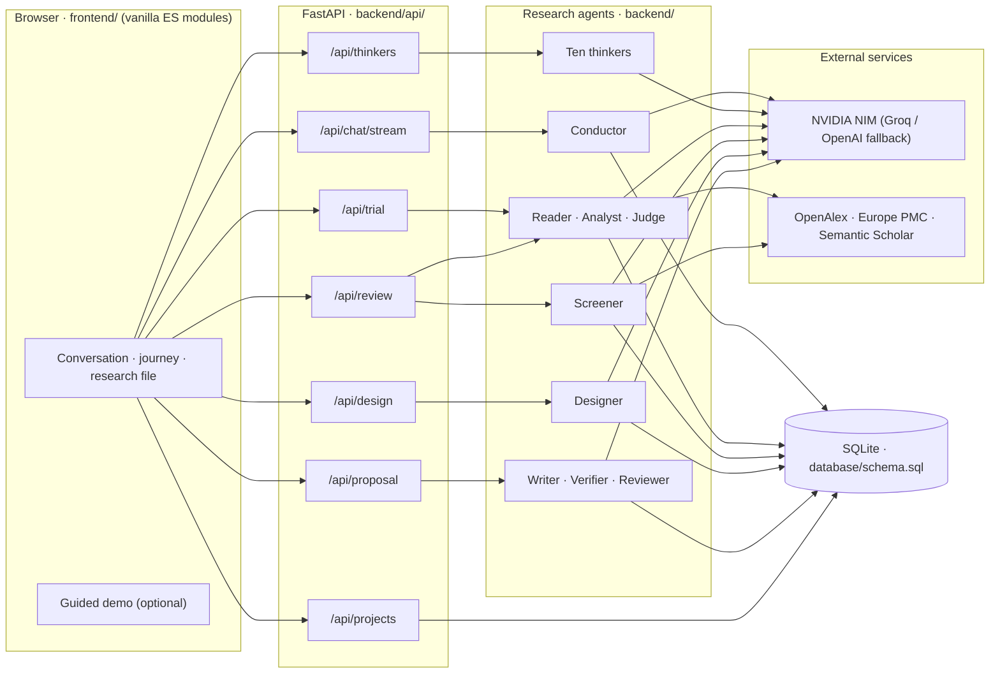

# Architecture

Thoth is one Python service (FastAPI) that serves a JSON/SSE API and the browser UI, with SQLite for storage.
There is no build step and no separate frontend server.



## Request flow

```
Browser
  ├─ POST /api/chat/stream    an ordinary turn → the conductor: replies, quick looks, research-file proposals,
  │                           offers of a trial or a systematic review (the UI opens them on accept);
  │                           { idea_promotion } → the idea is kept (only on an explicit user action)
  ├─ /api/thinkers/*          council · debate · reviews · one-to-one replies (dossier-driven personas)
  ├─ /api/trial/*             plan (sub-claims, cost) → approve → run (SSE: papers → matrix → ruling) · stop
  ├─ /api/review/*            protocol → approve (Auto / Human-in-the-loop) → PRISMA counts from recorded decisions
  ├─ /api/design/*            resources → candidate designs → choose → revise
  ├─ /api/proposal/*          outline → approve → write (SSE) → verify → review → export (asks first)
  └─ /api/projects/*          list · create · delete (with counts) · state · versions · rivals · mode
```

- Every costly step shows its plan and cost first and runs only on an explicit approval flag. There are no
  test-only bypasses.
- Streams are Server-Sent Events: `data: {"event": …, "payload": …}`.
- Work interrupted by a restart is marked stopped at startup, never left "running".

## Backend layout

| Package | What it holds |
|---|---|
| `backend/main.py` | The app: routers, static mounts for the UI, no-cache headers for UI modules |
| `backend/api/` | One router per feature (chat, projects, thinkers, trial, review, design, proposal, health) |
| `backend/conversation/` | `conductor.py` (one agent per chat turn), `idea.py` (explicit idea promotion), `projects.py` (project state, versions, rivals, modes, deletion) |
| `backend/thinkers/` | `roster.py`, `persona.py` (prompt from a dossier), `modes.py` (council, debate, review, room), `dossiers/` |
| `backend/research/` | `librarian` (search, full text) · `reader` (neutral paper records) · `appraisal` (design checklists) · `citations` · `analyst` (sub-claims, matrix rows) · `judge` (the ruling) · `trial` (the run) · `store` · `review` + `review_store` (systematic review) · `designer` · `hypothesis` (strength markers) · `writer` · `verifier` · `reviewer` · `proposal` · `llm` (JSON calls) |
| `backend/memory/` | `db.py` (SQLite, applies `database/schema.sql`), `conversation_store.py` (turns, summaries, the research file), `rationale.py` (why a version changed) |
| `backend/intellectual_rigour/` | `integrity_gate.py`: deterministic checks on numbers and the bibliography |
| `backend/agents.py` | `get_role_llm`, `FallbackLLMWrapper`, log sanitising, JSON extraction |
| `backend/scholarly.py`, `dispatcher.py`, `ingestion.py` | Semantic Scholar client, circuit breakers and rate limiting, PDF text extraction |

## Research integrity in code

- A paper's access level (full text or abstract only) is recorded and never upgraded.
- The approve flags on trial, review and proposal runs are the only paths into expensive compute.
- Verifier findings degrade a proposal to provisional; they never silently delete claims.
- The Judge's "likely novel" and "already established" are lowered by code when the evidence does not allow
  them, and the note saying so is shown.
- Every PRISMA count is computed from recorded screening decisions.
- The guided demo replays recorded real runs only; its fixtures are never hand-written.

## Storage

SQLite only (`database/thoth.db` by default, `THOTH_DB_PATH` to change it). The schema is
[`database/schema.sql`](../database/schema.sql), applied idempotently at startup. Twelve tables: projects,
ideas, conversation turns and summaries, proposals, the research file (versioned sections), thinker memory,
trials and their papers, systematic reviews with their records and searches.

## Tests

`backend/tests/scenarios/` holds scenario tests (S10–S27), each tied to a section of the vision and written
from the user's side. They run offline: model calls and literature fetchers are stubbed. One live-model test
(thinkers distinguishable blind) runs only with `THOTH_LIVE_TESTS=1`.

---

<sub>Thoth · Developed by Shayan Azmi</sub>
