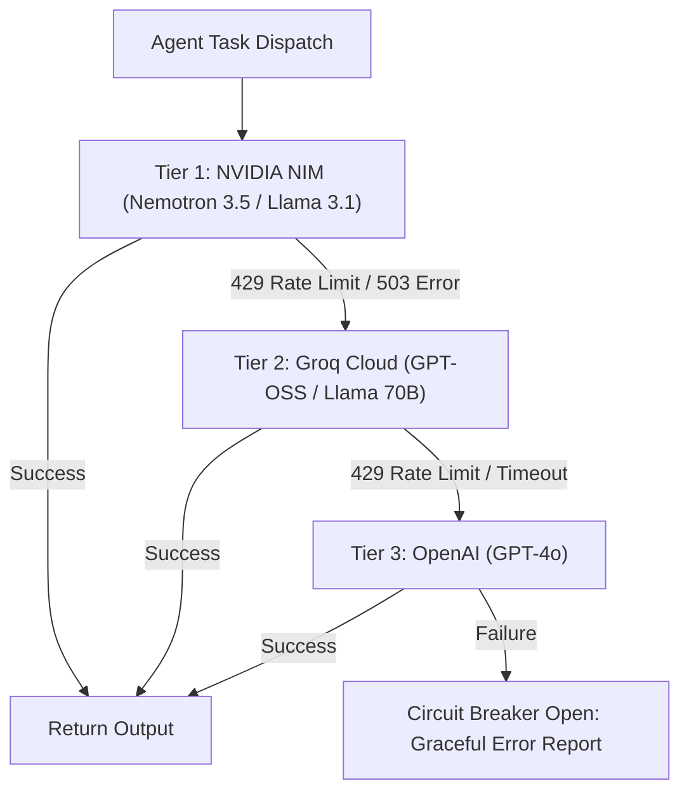

# 🛡️ API Limit Handling, Rate Limiting & Provider Resilience

This document outlines the resilience and rate-limit architecture in Thoth, derived from our **Feynman Architecture Study** on high-speed, cost-effective LLM pipelines.

---

## 1. Core Principles from the Feynman Study

### Principle 1: Scoped Payloads Over Monolithic Blobs
Never pass the entire research transcript to every sub-agent. Each agent receives only its necessary slice:
- **Search Agent:** Receives only refined query strings.
- **Scrape Agent:** Receives target URLs.
- **Truth Guard:** Receives only atomic claims and corresponding source passages.
- **Critic Agent:** Receives the drafted report and rubric criteria.
*Outcome:* 60% lower token consumption, faster inference, and immunity to token window limits.

### Principle 2: Three-Tier Multi-Provider Fallback
API rate limits (HTTP 429) or upstream outages (HTTP 503) trigger immediate, transparent failover:



### Principle 3: Token Bucket Rate Limiting (Redis-Backed)
Outbound calls to external APIs are metered through a Redis-backed token bucket algorithm to avoid exceeding provider tier boundaries:
```python
# backend/core/rate_limit.py
import time
from typing import Tuple
import redis.asyncio as aioredis

class TokenBucketLimiter:
    def __init__(self, redis_client: aioredis.Redis, capacity: int, fill_rate_per_sec: float):
        self.redis = redis_client
        self.capacity = capacity
        self.fill_rate = fill_rate_per_sec

    async def acquire(self, key: str, tokens: int = 1) -> Tuple[bool, float]:
        now = time.time()
        bucket_key = f"thoth:ratelimit:bucket:{key}"
        
        # Redis pipeline for atomic token evaluation
        pipe = self.redis.pipeline()
        pipe.hget(bucket_key, "tokens")
        pipe.hget(bucket_key, "last_updated")
        results = await pipe.execute()
        
        current_tokens = float(results[0]) if results[0] else float(self.capacity)
        last_updated = float(results[1]) if results[1] else now

        # Add regenerated tokens
        elapsed = now - last_updated
        current_tokens = min(float(self.capacity), current_tokens + (elapsed * self.fill_rate))

        if current_tokens >= tokens:
            current_tokens -= tokens
            await self.redis.hset(bucket_key, mapping={
                "tokens": current_tokens,
                "last_updated": now
            })
            return True, 0.0
        else:
            wait_time = (tokens - current_tokens) / self.fill_rate
            return False, wait_time
```

---

## 2. Exponential Backoff with Jitter

For intermittent network glitches, HTTP 500, or transient rate spikes, calls utilize randomized full-jitter backoff via `tenacity`:

```python
from tenacity import retry, wait_random_exponential, stop_after_attempt, retry_if_exception_type

@retry(
    wait=wait_random_exponential(multiplier=1.0, max=10.0),
    stop=stop_after_attempt(3),
    retry=retry_if_exception_type((TimeoutError, ConnectionError))
)
async def resilient_api_call(payload: dict):
    # API invocation logic
    pass
```

---

## 3. Circuit Breakers for Pipeline Safety

To prevent infinite loops during deep multi-turn research, Thoth enforces circuit breakers:
- **Max Follow-up Turns:** Clamped to 8 turns per session.
- **Max Citation Snowball Depth:** Clamped to depth 2.
- **Max Scraped Paper Count:** Configurable per user (`15` default, clamped between `5` and `30`).
- **Token Budget Slicer:** The `backend.memory.session` automatically truncates conversation context if it exceeds the model's comfortable prompt window (e.g. 8,192 tokens), preserving the system prompt and the most recent substantive turns.
