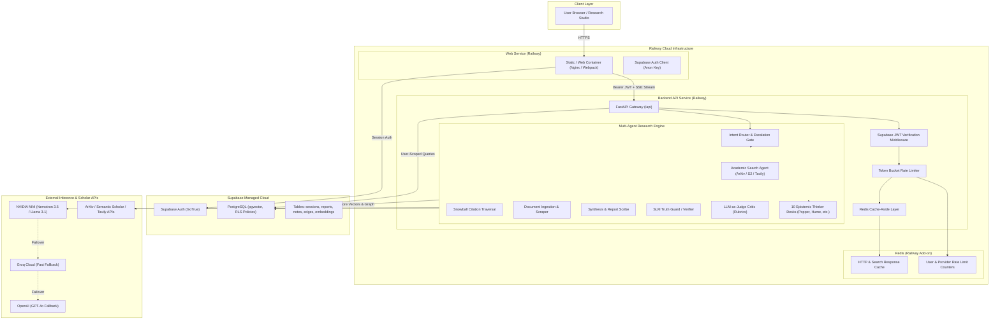

# 🏛️ Thoth Architecture Specification

## 1. System Overview

**Thoth** (The Divine Scribe of Ma'at) is a production-grade autonomous research intelligence platform designed to eliminate hallucinations and intellectual drift in complex synthetic research. It combines multi-agent recursive retrieval, dual-key claim-evidence provenance verification, 10 epistemological reasoning frameworks, a persistent knowledge vault graph, and strict rate-limiting / caching infrastructure.

### Target Deployment Topology
- **Web Frontend:** Deployed as an independent static / SPA service on **Railway**.
- **Backend API & Orchestration Engine:** FastAPI service deployed on **Railway**.
- **Identity & Relational Database:** **Supabase** (Auth, PostgreSQL with Row Level Security, pgvector for semantic search).
- **Caching & Rate-Limiting:** **Redis** (Railway Add-on or managed Redis) for API caching, session storage, and token bucket rate limits.

---

## 2. High-Level Architecture Diagram



---

## 3. Core Component Breakdown

### 3.1 Web Frontend (`web/`)
- **Role:** Interactive research workspace with real-time SSE streaming, mindmap graph visualization, telemetry indicators, and philosopher sparring modals.
- **Authentication:** Direct connection to Supabase via `@supabase/supabase-js` using the public `SUPABASE_ANON_KEY`. No secret keys are stored in the client.
- **Network Protocol:**
  - Standard REST calls with `Authorization: Bearer <JWT>` for session and note queries.
  - Server-Sent Events (`EventSource` / `fetch-event-source`) for streaming research synthesis, real-time logs, and thinker dialogue.

### 3.2 Backend Service (`backend/`)
Organized following clean hexagonal / layered architecture:
- `api/`: Route definitions (`/api/research`, `/api/followup`, `/api/brainstorm`, `/api/vault`, `/api/health`).
- `services/`: Core business logic (`orchestrator.py`, `pipeline.py`, `sparring_service.py`).
- `repositories/`: Database abstraction over Supabase PostgreSQL (`session_repo.py`, `report_repo.py`, `vault_repo.py`).
- `core/`: Cross-cutting concerns (`config.py`, `auth.py`, `cache.py`, `rate_limit.py`, `logging.py`, `errors.py`).
- `models/`: Strictly validated Pydantic v2 schemas for domain entities and HTTP contracts.

### 3.3 Supabase Data Layer (`backend/supabase/`)
- **Row Level Security (RLS):** Every database table (`sessions`, `reports`, `notes`, `edges`, `embeddings`) enforces tenant isolation:
  ```sql
  CREATE POLICY user_isolation ON sessions
    FOR ALL USING (auth.uid() = user_id);
  ```
- **Vector Search:** Embeddings are indexed using `pgvector` (`vector(384)` with `ivfflat` cosine index), replacing local SQLite BLOBs.

### 3.4 Redis Add-on
- **Key Namespaces:**
  - `thoth:cache:http:{sha256}`: Cached scholar search results (TTL 24h).
  - `thoth:ratelimit:user:{user_id}`: Per-user token bucket limiters.
  - `thoth:ratelimit:provider:{provider_name}`: Global egress throttle to prevent LLM quota exhaustion.
- **Fail-Open Resilience:** If Redis connectivity drops, the cache layer gracefully degrades to in-memory LRU or direct upstream fetch without crashing requests.

---

## 4. Multi-Agent Pipeline & Epistemic Desks

### 8-Stage Research Pipeline
1. **Search Node:** Dispatches queries across ArXiv, Semantic Scholar, and Tavily.
2. **Snowball Node:** Parses citations from top candidate papers to discover adjacent literature.
3. **Scrape Node:** Fetches full text and extracts clean Markdown, enforcing strict provenance.
4. **Writer Node:** Synthesizes multi-source findings into an evidence-backed report.
5. **Truth Guard (Verifier):** Validates every atomic quantitative claim against extracted sources.
6. **Critic Node:** Evaluates the draft across coherence, counterfactual depth, and rigour rubrics.
7. **Mindmap Node:** Extracts hierarchical concepts and relations into structured JSON.
8. **Vault Node:** Indexes facts and cross-document relational edges in the knowledge graph.

### 10 Intellectual Rigour Thinker Frameworks
Located in `backend/intellectual_rigour/frameworks/`:
- **Aristotle:** Syllogistic deduction, categorical taxonomy, non-contradiction.
- **Bacon:** Inductive empiricism, systematic observation, rejection of idols.
- **Descartes:** Radical doubt, foundational truths, decomposition of complexity.
- **Hume:** Empiricist skepticism, constant conjunction vs causality, induction critique.
- **Darwin:** Evolutionary adaptation, variation, differential fitness of hypotheses.
- **Popper:** Falsifiability criterion, aggressive refutation, conjecture testing.
- **Kuhn:** Paradigm shift analysis, anomaly accumulation, revolution detection.
- **Simon:** Bounded rationality, satisficing heuristics, computational constraints.
- **Turing:** Operational computability, algorithmic state machines, imitation test.
- **Box:** Pragmatic model fallibilism ("All models are wrong, some are useful").
