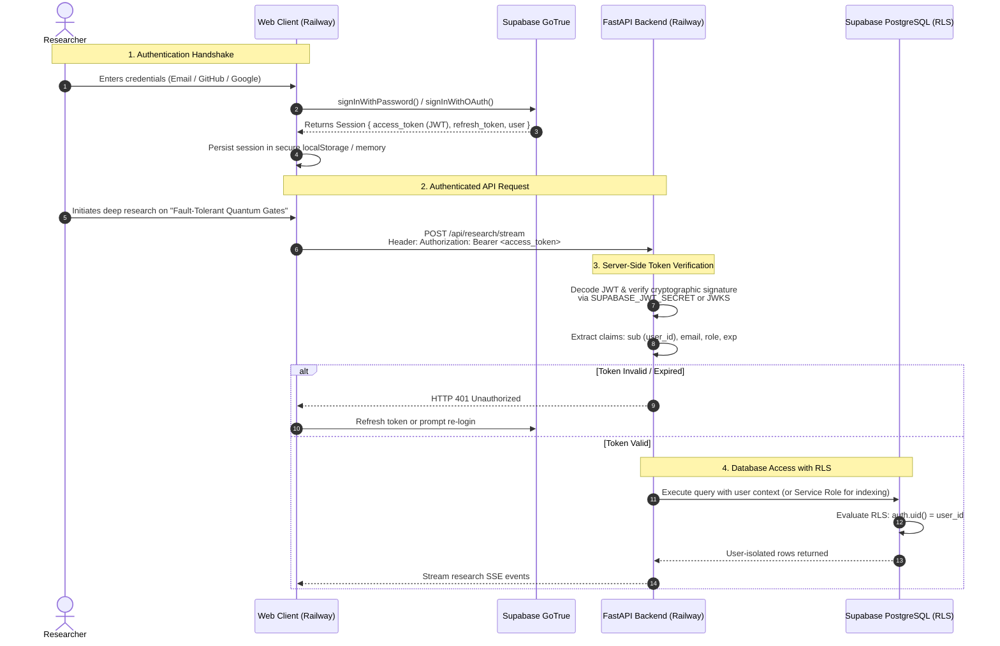

# 🔐 Supabase Authentication & Authorization Flow

This document details the end-to-end security architecture of Thoth, covering client-side session handling, FastAPI JWT verification, and Row Level Security (RLS) in PostgreSQL.

---

## 1. Authentication Lifecycle Sequence



---

## 2. Client-Side Security (`web/lib/supabase.js`)

### Zero Service-Key Policy
The frontend only has access to:
- `SUPABASE_URL`
- `SUPABASE_ANON_KEY`

Under no circumstances is `SUPABASE_SERVICE_ROLE_KEY` embedded or bundled into the client application.

### Session Lifecycle Management
```javascript
// web/lib/supabase.js
import { createClient } from '@supabase/supabase-js';
import { CONFIG } from './config.js';

export const supabase = createClient(CONFIG.SUPABASE_URL, CONFIG.SUPABASE_ANON_KEY, {
  auth: {
    autoRefreshToken: true,
    persistSession: true,
    detectSessionInUrl: true
  }
});

// Broadcast auth state transitions
supabase.auth.onAuthStateChange((event, session) => {
  if (event === 'SIGNED_IN') {
    window.dispatchEvent(new CustomEvent('thoth:auth:change', { detail: session }));
  } else if (event === 'SIGNED_OUT') {
    window.dispatchEvent(new CustomEvent('thoth:auth:signout'));
  }
});
```

---

## 3. Server-Side JWT Verification (`backend/core/auth.py`)

FastAPI intercepts all incoming requests with an authentication dependency:

```python
# backend/core/auth.py
from fastapi import Depends, HTTPException, status
from fastapi.security import HTTPBearer, HTTPAuthorizationCredentials
import jwt
from backend.core.config import get_settings

security = HTTPBearer(auto_error=False)

async def get_current_user(
    credentials: HTTPAuthorizationCredentials = Depends(security)
) -> dict:
    if not credentials:
        raise HTTPException(
            status_code=status.HTTP_401_UNAUTHORIZED,
            detail="Missing Authorization Bearer token."
        )

    token = credentials.credentials
    settings = get_settings()

    try:
        payload = jwt.decode(
            token,
            settings.SUPABASE_JWT_SECRET,
            algorithms=["HS256"],
            audience="authenticated"
        )
        user_id = payload.get("sub")
        if not user_id:
            raise HTTPException(status_code=401, detail="Malformed JWT claims: missing sub.")
        return payload
    except jwt.ExpiredSignatureError:
        raise HTTPException(status_code=401, detail="Authorization token has expired.")
    except jwt.InvalidTokenError as e:
        raise HTTPException(status_code=401, detail=f"Invalid authorization token: {str(e)}")
```

---

## 4. Row Level Security (RLS) Strategy

All tables in the database have RLS turned on:

```sql
-- Enable RLS
ALTER TABLE sessions ENABLE ROW LEVEL SECURITY;
ALTER TABLE reports ENABLE ROW LEVEL SECURITY;
ALTER TABLE notes ENABLE ROW LEVEL SECURITY;

-- Standard Multi-Tenant User Isolation Policy
CREATE POLICY "Users can only read and write their own sessions"
  ON sessions
  FOR ALL
  USING (auth.uid() = user_id)
  WITH CHECK (auth.uid() = user_id);
```

When users query the database directly through the Supabase client or via user-scoped backend connections, Postgres prevents unauthorized cross-tenant data leaks.
