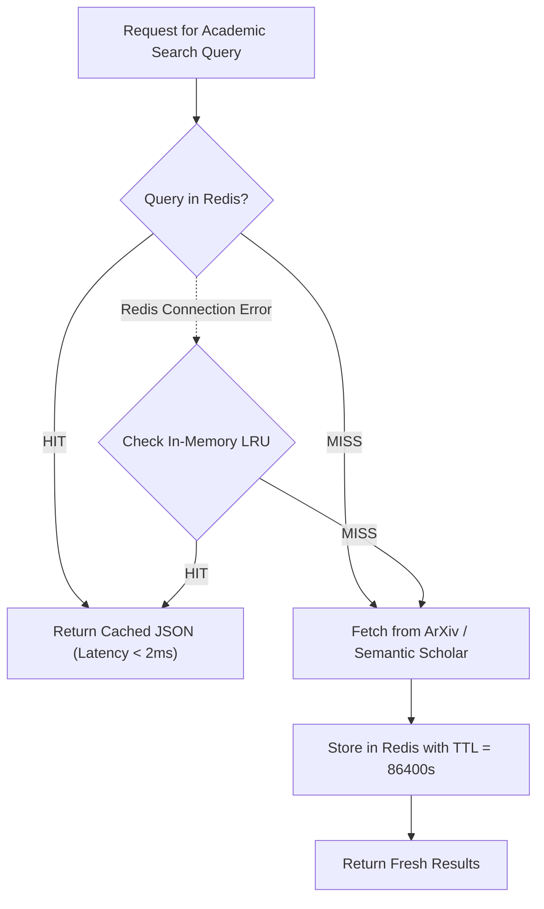

# ⚡ Redis Caching & Invalidation Architecture

This document specifies the caching and rate-limiting infrastructure for Thoth using **Redis** (Railway Add-on).

---

## 1. Objectives & Guarantees
- **Latency Reduction:** Eliminate redundant latency by caching costly external academic queries (ArXiv XML, Semantic Scholar JSON, Tavily scrapes).
- **Cost Reduction:** Protect LLM token budgets by caching deterministic sparring responses and embedding lookups.
- **Quota Protection:** Throttle requests against upstream provider rate limits (NVIDIA NIM, Groq, OpenAI).
- **Fail-Open Fault Tolerance:** If Redis becomes unavailable, the application seamlessly falls back to local in-memory LRU caching without interrupting active user research streams.

---

## 2. Key Namespaces & TTL Strategy

| Key Pattern | Purpose | Data Type | Default TTL | Invalidation Trigger |
| :--- | :--- | :--- | :--- | :--- |
| `thoth:cache:scholar:{hash}` | Academic search results & abstracts | String (JSON) | 86,400s (24h) | Time expiry or manual cache flush |
| `thoth:cache:scraped:{url_hash}` | Raw extracted web/PDF text content | String (JSON) | 604,800s (7d) | Time expiry |
| `thoth:cache:thinker:{tid}:{hash}` | Epistemic sparring precomputations | String (JSON) | 43,200s (12h) | Model / spec version change |
| `thoth:ratelimit:user:{uid}` | Per-user token bucket limiter | Hash (tokens, ts) | 60s | Rolling refill |
| `thoth:ratelimit:provider:{name}` | Upstream LLM RPM / TPM gate | Hash (count, ts) | 60s | Rolling window |

---

## 3. Cache-Aside Implementation Pattern



### Python Implementation Pattern (`backend/core/cache.py`)

```python
import json
import logging
from typing import Optional, Any
import redis.asyncio as aioredis
from backend.core.config import get_settings

logger = logging.getLogger("ThothCache")

class RedisCacheManager:
    def __init__(self):
        self._redis: Optional[aioredis.Redis] = None
        self._memory_fallback: dict = {}

    async def get_client(self) -> Optional[aioredis.Redis]:
        if self._redis is None:
            settings = get_settings()
            try:
                self._redis = aioredis.from_url(
                    settings.REDIS_URL,
                    encoding="utf-8",
                    decode_responses=True,
                    socket_connect_timeout=2.0
                )
                await self._redis.ping()
            except Exception as e:
                logger.warning(f"Redis unavailable ({e}). Operating in memory-fallback mode.")
                self._redis = None
        return self._redis

    async def get(self, key: str) -> Optional[Any]:
        client = await self.get_client()
        if client:
            try:
                val = await client.get(key)
                return json.loads(val) if val else None
            except Exception as e:
                logger.error(f"Redis get error for {key}: {e}")
        return self._memory_fallback.get(key)

    async def set(self, key: str, value: Any, ttl: int = 86400) -> None:
        client = await self.get_client()
        serialized = json.dumps(value)
        if client:
            try:
                await client.set(key, serialized, ex=ttl)
                return
            except Exception as e:
                logger.error(f"Redis set error for {key}: {e}")
        self._memory_fallback[key] = value

    async def delete(self, key: str) -> None:
        client = await self.get_client()
        if client:
            try:
                await client.delete(key)
            except Exception as e:
                logger.error(f"Redis delete error for {key}: {e}")
        self._memory_fallback.pop(key, None)
```

---

## 4. Cache Invalidation & Administration

To invalidate cache entries across the system, use the CLI operational utility:

```bash
# Flush scholar search cache namespace
python scripts/ops/cache_flush.py --namespace thoth:cache:scholar

# Flush entire Thoth Redis cache
python scripts/ops/cache_flush.py --all --dry-run
python scripts/ops/cache_flush.py --all --force
```
