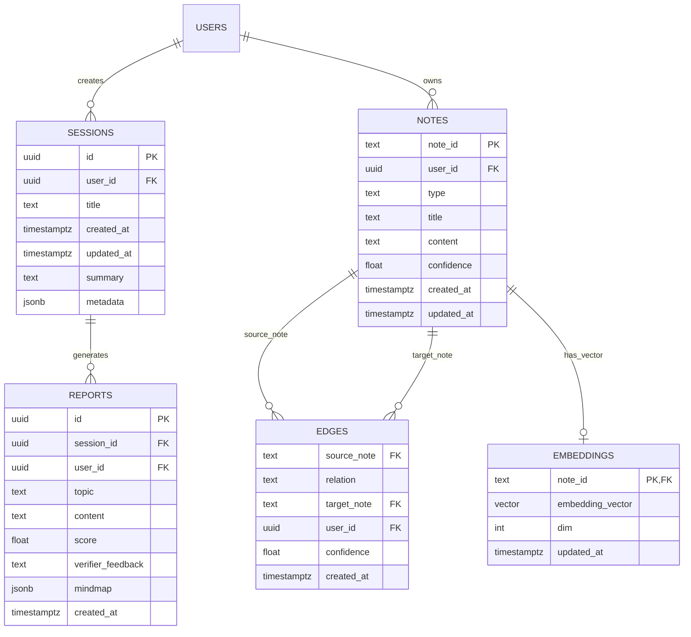

# 🗄️ Database Schema & PostgreSQL Migration Specification

This document details the relational data model for Thoth, replacing legacy SQLite (`store.db`) with **Supabase PostgreSQL**, enabling **pgvector** for semantic similarity and **Row Level Security (RLS)** for multi-tenant isolation.

---

## 1. Entity-Relationship Diagram



---

## 2. Table Specifications & DDL

### 2.1 Extension Setup
```sql
CREATE EXTENSION IF NOT EXISTS "uuid-ossp";
CREATE EXTENSION IF NOT EXISTS "vector";
```

### 2.2 `sessions` Table
Stores user research sessions, conversation state, and metadata.
```sql
CREATE TABLE IF NOT EXISTS public.sessions (
    id UUID PRIMARY KEY DEFAULT gen_random_uuid(),
    user_id UUID NOT NULL REFERENCES auth.users(id) ON DELETE CASCADE,
    title TEXT NOT NULL,
    summary TEXT DEFAULT '',
    metadata JSONB DEFAULT '{}'::jsonb,
    created_at TIMESTAMPTZ NOT NULL DEFAULT timezone('utc'::text, now()),
    updated_at TIMESTAMPTZ NOT NULL DEFAULT timezone('utc'::text, now())
);

CREATE INDEX idx_sessions_user_id ON public.sessions(user_id);
CREATE INDEX idx_sessions_created_at ON public.sessions(created_at DESC);
```

### 2.3 `reports` Table
Stores validated reports, critic scores, verifier feedback, and mindmaps.
```sql
CREATE TABLE IF NOT EXISTS public.reports (
    id UUID PRIMARY KEY DEFAULT gen_random_uuid(),
    session_id UUID NOT NULL REFERENCES public.sessions(id) ON DELETE CASCADE,
    user_id UUID NOT NULL REFERENCES auth.users(id) ON DELETE CASCADE,
    topic TEXT NOT NULL,
    content TEXT NOT NULL,
    score DOUBLE PRECISION DEFAULT 0.0,
    verifier_feedback TEXT DEFAULT '',
    mindmap JSONB DEFAULT '{}'::jsonb,
    created_at TIMESTAMPTZ NOT NULL DEFAULT timezone('utc'::text, now())
);

CREATE INDEX idx_reports_session_id ON public.reports(session_id);
CREATE INDEX idx_reports_user_id ON public.reports(user_id);
```

### 2.4 `notes` Table (Knowledge Vault)
Atomic knowledge units and paper abstracts ingested by the multi-agent pipeline.
```sql
CREATE TABLE IF NOT EXISTS public.notes (
    note_id TEXT PRIMARY KEY,
    user_id UUID NOT NULL REFERENCES auth.users(id) ON DELETE CASCADE,
    type TEXT NOT NULL, -- 'source', 'topic', 'claim', 'fact'
    title TEXT DEFAULT '',
    content TEXT NOT NULL,
    confidence DOUBLE PRECISION DEFAULT 1.0,
    created_at TIMESTAMPTZ NOT NULL DEFAULT timezone('utc'::text, now()),
    updated_at TIMESTAMPTZ NOT NULL DEFAULT timezone('utc'::text, now())
);

CREATE INDEX idx_notes_user_id ON public.notes(user_id);
CREATE INDEX idx_notes_type ON public.notes(type);
```

### 2.5 `edges` Table (Knowledge Graph)
Inter-note relational connections with semantic qualifiers.
```sql
CREATE TABLE IF NOT EXISTS public.edges (
    source_note TEXT NOT NULL REFERENCES public.notes(note_id) ON DELETE CASCADE,
    relation TEXT NOT NULL CHECK (relation IN ('cites', 'supports', 'contradicts', 'part_of', 'defines', 'related')),
    target_note TEXT NOT NULL REFERENCES public.notes(note_id) ON DELETE CASCADE,
    user_id UUID NOT NULL REFERENCES auth.users(id) ON DELETE CASCADE,
    confidence DOUBLE PRECISION DEFAULT 1.0,
    created_at TIMESTAMPTZ NOT NULL DEFAULT timezone('utc'::text, now()),
    PRIMARY KEY (source_note, relation, target_note)
);

CREATE INDEX idx_edges_user_id ON public.edges(user_id);
CREATE INDEX idx_edges_target ON public.edges(target_note);
```

### 2.6 `embeddings` Table (Vector Semantic Search)
Dense semantic vector representation using `pgvector`.
```sql
CREATE TABLE IF NOT EXISTS public.embeddings (
    note_id TEXT PRIMARY KEY REFERENCES public.notes(note_id) ON DELETE CASCADE,
    vector vector(384) NOT NULL, -- HuggingFace all-MiniLM-L6-v2 dimension
    dim INTEGER NOT NULL DEFAULT 384,
    updated_at TIMESTAMPTZ NOT NULL DEFAULT timezone('utc'::text, now())
);

-- Cosine Distance Vector Index (IVFFlat)
CREATE INDEX idx_embeddings_vector ON public.embeddings 
USING ivfflat (vector vector_cosine_ops) WITH (lists = 100);
```

---

## 3. Row Level Security Policies

Every table is protected with mandatory RLS policies:
```sql
ALTER TABLE public.sessions ENABLE ROW LEVEL SECURITY;
ALTER TABLE public.reports ENABLE ROW LEVEL SECURITY;
ALTER TABLE public.notes ENABLE ROW LEVEL SECURITY;
ALTER TABLE public.edges ENABLE ROW LEVEL SECURITY;
ALTER TABLE public.embeddings ENABLE ROW LEVEL SECURITY;

CREATE POLICY "Users can manage their own sessions"
    ON public.sessions FOR ALL
    USING (auth.uid() = user_id)
    WITH CHECK (auth.uid() = user_id);

CREATE POLICY "Users can manage their own reports"
    ON public.reports FOR ALL
    USING (auth.uid() = user_id)
    WITH CHECK (auth.uid() = user_id);

CREATE POLICY "Users can manage their own notes"
    ON public.notes FOR ALL
    USING (auth.uid() = user_id)
    WITH CHECK (auth.uid() = user_id);

CREATE POLICY "Users can manage their own edges"
    ON public.edges FOR ALL
    USING (auth.uid() = user_id)
    WITH CHECK (auth.uid() = user_id);
```

---

## 4. SQLite Migration Strategy
1. The migration utility `scripts/db/migrate_sqlite_to_supabase.py` reads existing tables from `store.db`.
2. Existing rows are transformed into typed dictionaries and loaded using batch upserts.
3. Once migrated, `store.db` is moved to `archive/legacy_db/store.db`.
