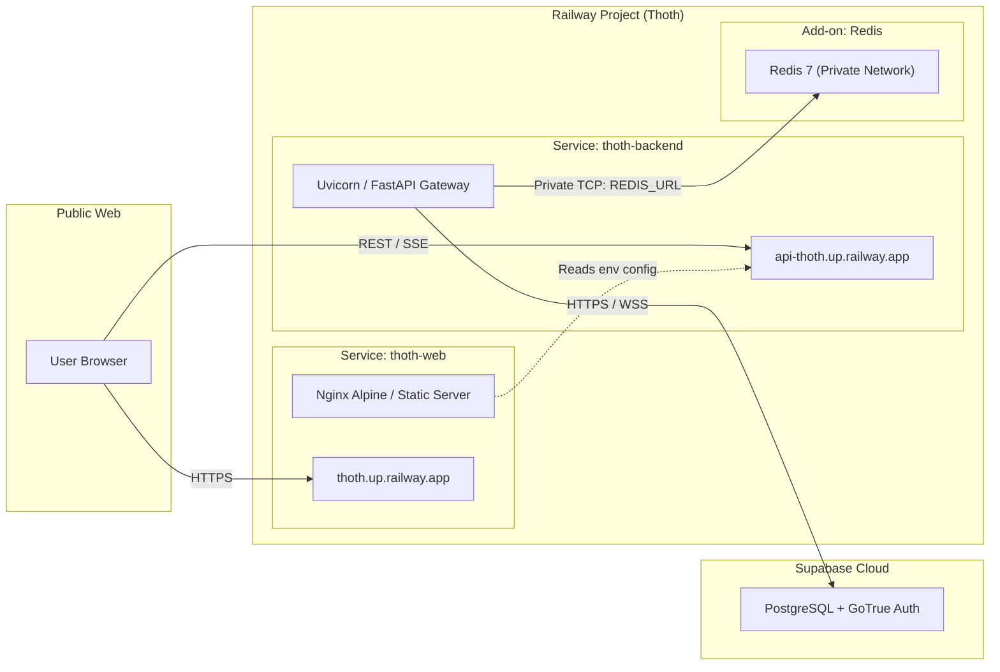

# 🚀 Railway Multi-Service Deployment Guide

This document describes how to deploy Thoth to **Railway** as a coordinated multi-service monorepo.

---

## 1. Railway Infrastructure Topology



---

## 2. Service Configurations

### 2.1 Backend Service (`backend/railway.toml`)
Configures the Python FastAPI backend:
```toml
[build]
builder = "NIXPACKS"
buildCommand = "pip install -r backend/requirements.txt"

[deploy]
startCommand = "uvicorn backend.main:app --host 0.0.0.0 --port $PORT"
healthcheckPath = "/health"
healthcheckTimeout = 120
restartPolicyType = "ON_FAILURE"
restartPolicyMaxRetries = 5
```

### 2.2 Web Service (`frontend/railway.toml`)
Configures the static web frontend:
```toml
[build]
builder = "DOCKERFILE"
dockerfilePath = "frontend/Dockerfile"

[deploy]
healthcheckPath = "/health"
restartPolicyType = "ON_FAILURE"
```

### 2.3 Web Containerfile (`frontend/Dockerfile`)
```dockerfile
FROM nginx:alpine
RUN rm -rf /usr/share/nginx/html/*
COPY . /usr/share/nginx/html
COPY nginx.conf /etc/nginx/conf.d/default.conf
EXPOSE 80
CMD ["nginx", "-g", "daemon off;"]
```

---

## 3. Deployment Steps via Railway CLI

### Step 1: Install & Authenticate
```bash
npm i -g @railway/cli
railway login
```

### Step 2: Initialize or Link Project
```bash
railway link
```

### Step 3: Provision Redis Add-on
In the Railway Dashboard:
1. Click **New → Database → Add Redis**.
2. Railway automatically provisions Redis and provides the connection variable `${{Redis.REDIS_URL}}`.

### Step 4: Inject Environment Secrets
In the Backend service settings on Railway, configure:
- `SUPABASE_URL`
- `SUPABASE_ANON_KEY`
- `SUPABASE_SERVICE_ROLE_KEY`
- `SUPABASE_JWT_SECRET`
- `REDIS_URL` = `${{Redis.REDIS_URL}}`
- `NVIDIA_API_KEY`
- `GROQ_API_KEY`
- `OPENAI_API_KEY`
- `TAVILY_API_KEY`

In the Web service settings, configure:
- `API_BASE_URL` = `https://api-thoth.up.railway.app`
- `SUPABASE_URL` = your Supabase URL
- `SUPABASE_ANON_KEY` = your public Supabase Anon key

### Step 5: Deploy
```bash
# Trigger build & deployment
railway up
```
Railway automatically conducts health checks on `/health` before cutting over traffic, ensuring zero-downtime rolling upgrades.
