# 10 · UI revamp: "The Folio"

> Status: **built** (Folio layout; later restyled Obsidian & Gold with motion and a new intro: `docs/archive/verify/demo_tour.md`). Written 25 Oct 2026. The clickable prototype now lives in `docs/archive/superseded/design/ui-revamp/`.
> Stack is unchanged: vanilla ES modules, no build step, CSS tokens in `frontend/styles/tokens.css`.
> Prototype: open [`docs/archive/superseded/design/ui-revamp/index.html`](../archive/superseded/design/ui-revamp/index.html) directly in a browser
> (deep links: `?stage=check|thinkers|design&mode=chat|split|folio&theme=light|dark&drawer=W3`).
> Anchors: `CLAUDE.md` §1 (principles), `00-overview.md`, `03-thinkers.md`, `06-trial.md`, `07-study-design.md`.
> Rules kept: no mode toggles (fast_chat / deep_research / brainstorm); one unified conversation; nothing costly without approval.

## 1. Audit of the current UI

Done live on 25 Oct 2026 against the night-shift-nurses project (51 messages, one hypothesis, a 15-witness trial, three design reviews), at 1024 px desktop and 375 px phone, light and dark. Screenshots were viewed in the in-app browser; the prototype screenshots in §9 are the saved evidence.

### What works and must survive
- The brand is already right: paper and ink, night indigo, red-ochre rubric, Newsreader serif, the Ink-moon mark, moon-phase journey. It reads as a scholarly tool and not as another chat clone.
- The honesty vocabulary (full text vs abstract only, "Insufficient evidence", "Not covered by these 15 papers") is the product's real differentiator. The UI should make it louder, not hide it.
- Journey stepper as navigation; slash commands; hypothesis as a first-class object.

### What holds it back (ranked by impact)

| # | Problem | Evidence | Effect |
|---|---|---|---|
| 1 | **The workspace is a narrow side panel** (`--workspace-w: minmax(360px, 36%)`, 460 px at 1024) that must hold the verdict, four sub-claims, a 15-row matrix, gaps and suggestions in one scroll | The Check panel is a long vertical stack; verdict text wraps in a ~330 px column; the matrix is a list of cards, not a matrix | The product's signature output (the trial) has the least room of anything on screen. A researcher cannot compare rows or see the pattern |
| 2 | **The verdict has no ceremony.** "Insufficient evidence" is a 1.1 rem serif heading with a grey left border | `trial.js` verdict block | The single most important sentence in a session looks like any other card |
| 3 | **The matrix hides its own finding.** 15 rows × 4 claims; 13 rows are all dots; each row repeats a full title card | Matrix text dump: only W3 and W15 have a mark | The user has to scan 60 cells to learn "two papers say anything". Silence should be summarised, with the detail one click away |
| 4 | **Pinned hypothesis card eats the chat.** Question + hypothesis + 5 text links sit above the messages, and the messages fade under it | At 800×600 the card takes ~35% of the height; at 375 px, ~45%, and the action links wrap to three lines | Conversation is supposed to be first (vision §2); on a phone it is squeezed out |
| 5 | **Native `window.prompt()` dialogs** for editing proposals (`chat.js:363`), choosing a design (`design.js:105`) and "I say" readings (`trial.js:243`) | Browser-chrome dialogs, no styling, no multiline, no dark mode, not themed | Breaks the illusion at the three moments the user is making a real decision |
| 6 | **Thinker debate is a list of rows** (name · "OBJECTING" pill · "2 CRITICAL" pill) | Reviews card in the Design stage | Disagreement, the whole point of thinkers, is invisible. You cannot see who argues what, or where they clash. Pills wrap badly at phone width ("2 / CRITICAL" over two lines) |
| 7 | **All-caps mono kickers everywhere** (`INDEPENDENT REVIEWS OF YOUR STUDY DESIGN · WRITTEN WITHOUT SEEING EACH OTHER`) | Every card, every panel | Everything shouts the same; hierarchy flattens; hard to read at 11 px |
| 8 | **Journey labels vs panel tabs duplicate navigation.** The topbar journey and the workspace has its own 7-tab strip (Ideas, Thinkers, Hypothesis, Check, Review, Design, Draft) | Both visible at once | Two controls, same destinations; the tab strip also overflows (Review, Design, Draft are cut off at 1024) |
| 9 | **No layout agency.** Workspace is open or shut; no way to give the file the whole screen, or the chat | `workspaceToggle` | Wide work (matrix, candidates) and conversational work cannot both be comfortable |
| 10 | **Flat depth and sameness.** Same white card for chat replies, cards, panels; thinkers are 26 px grey busts | `.card`, `.msg.thinker` | Co-authors with "their own minds" look like icons. No colour, voice or presence per thinker |
| 11 | **Motion is sparse and unmotivated** apart from the WebGL intro (which is impressive but is the only "wow" and is skipped on repeat visits); `beacon` pulses forever on the Check step | `app.css` | Nothing celebrates the moment a ruling lands, or shows a trial filling in live |
| 12 | **Accessibility gaps to verify**: `--ink-3` (#8f8a80 on #f8f7f3 ≈ 3.2:1) used for real content; verdict colours carry meaning by hue alone in some chips; modal-less prompts have no focus management | tokens + trial.js | Fails WCAG AA for small text; colour-only status |

## 2. Visual direction

**Keep the brand, raise the craft.** "The honest scribe" becomes a *manuscript spread*: the conversation is the scribe's talking, the research file is the page that fills in beside it. Everything bold lives in three places: the **ruling** (verdict), the **folio** (the file as a page with room), and the **thinkers** (each with a colour and a voice).

- **Paper with a margin rule.** Warm paper ground with faint grain; research-file pages are bright sheets with a thin rubric margin line at the left (manuscript ruling). Dark mode is "night": deep indigo-black ground, moonlit ink.
- **Type does the heavy lifting.** Newsreader at display size for verdicts and hypotheses (48–58 px, light weight, italic rubric accent word); IBM Plex Sans for UI; Plex Mono only for data (ids, weights, locators). Kicker labels drop to sentence-weight 11–12 px with letter-spacing, used once per surface, not on every card.
- **Colour discipline.** Indigo = Thoth and actions. Rubric = what needs your attention or what is not yet shown (the ruling, "Not assessed", objections). Claim-status colours (green / amber / red / grey) stay semantic and are always paired with a shape or word, never hue alone.
- **Thinkers get a colour and a monogram ring** (Popper rubric, Hume green, Nightingale ochre, …); busts remain on profile pages only. The ring colour is the thinker's identity everywhere: chat bubble avatar, debate column top edge, roster, review chips.
- **Signature moments** (the "damn"): the rotating **Ruling seal** with the Ink-moon, the **moon-phase journey** that fills as the file fills, the **matrix that develops column by column**, and the **layout that breathes** from chat to folio. The existing WebGL intro stays as the front door; the rest of the product earns its own wow without GPU effects.

### Three concepts considered

| | A · **The Folio** (recommended) | B · **The Night Desk** | C · **The Margin** |
|---|---|---|---|
| Idea | Chat and a *page*, side by side; the page can expand to full width. One continuous research file with a ruling seal, matrix, debate columns | Dark-first observatory: the journey is a lunar orbit around a central canvas; cards float on glass | No panel at all: artefacts (matrix, verdict, candidates) live inline in the chat as wide cards with marginalia |
| Wow | Verdict seal; matrix that develops; layout breathing | Ambient depth, glows, parallax | Everything in one scroll, very "conversation first" |
| Room for matrix / debate | **Excellent** (full width on demand) | Good, but glass cards fight dense data | Poor: wide tables inside a 760 px chat column |
| Honesty / legibility | Print-like contrast, strongest | Glow and translucency lower contrast; AA harder | Good, but the file loses its identity as one document |
| Risk | Layout mode state to manage | Reads "AI product"; loses paper brand; heavier CSS | Breaks "living research file" mental model (spec 00) |
| Build cost | Medium, file by file | High (blur, layering, perf on low-end) | Medium, but rewrites chat renderer |

**Recommendation: A.** It is the only concept that fixes audit #1 (room), keeps the paper brand, and gives each surface (conversation, file) its right-sized home. B's dark atmosphere is borrowed as the dark theme; C's inline cards are kept for *summaries* (the small "Ruling" card in chat that opens the folio).

## 3. Layout system

One shell, three **layout modes**, a persistent control (Chat · Split · File) at top right, and keyboard shortcuts. This is **not** a mode toggle in the forbidden sense: the conversation is always the same unified conversation; the modes only change how much screen each of the two surfaces gets.

```
Chat     [ ───────────── conversation ───────────── ]            file slides away; stage dot shows progress
Split    [ conversation ~0.8fr | research file ~1.5fr ]          default on desktop ≥1100 px
File     [rail 76px|──────────── research file ───────────]       chat collapses to a vertical rail; click it to return
```

- **Grid:** `grid-template-columns` on `.area` animates between modes (`.55s var(--ease)`; chat min 380 px in Split).
- **Auto-promotion:** opening the matrix, the debate or the candidates from chat switches Chat → Split. Clicking a wide artefact's "expand" switches to File. Clicking the chat rail returns to Split. The user's choice is remembered (`localStorage` per browser).
- **Top bar (64 px):** brand + project crumb (hidden <1560 px), the **journey** (7 moon phases, labelled; labels collapse to the current step <1320 px, still present for screen readers), command palette (⌘K), layout segmented control, theme toggle. The in-panel tab strip is **removed**: the journey is the only stage navigation (fixes #8).
- **Pinned hypothesis becomes a slim strip** (2 lines, clamps, expands on click) that does not overlap messages; question text moves to the folio's Hypothesis page (fixes #4).
- **The folio** scrolls independently, has a sticky header (stage title + Export), a max reading width of 1080 px, and a **detail drawer** (440 px, slides from the right inside the folio) for witnesses, dossiers and candidate details. No page navigation, no native dialogs.
- **Chat ⇄ folio links:** every folio object has a small chat-card twin (ruling card, candidate summary). The twin opens the folio on that object; the folio's "Ask about this" puts a quoted reference in the composer.

### Folio pages (one per journey stage)

| Stage | Page contents |
|---|---|
| Explore | Ideas the user is circling; pinned/tentative; "Promote" action (spec 02) |
| Thinkers | Roster (10, pick up to 3) → independent readings as **three columns** (one per thinker: signature question, 2 bullets, stance, Reply) → "Thoth's reading of the disagreement" band → CTA |
| Hypothesis | Display-size hypothesis, version timeline, question, sub-claims, ambiguities |
| Check | **Ruling** (seal, display verdict, 5-step scale, fact strip with read-depth bar) → four sub-claims with status → **Matrix** → gaps → "what would strengthen" → next actions |
| Review | Formal PRISMA/review status; estimate-first (spec 05) |
| Design | Candidate comparison (3-up, recommended one raised), meters, thinker objections, Choose sheet |
| Draft | Proposal sections filling in live (spec 08) |

## 4. The four showpiece surfaces

### 4.1 The Ruling (verdict)
- 150 px circular seal with the Ink-moon; slow-rotating text ring ("THE RULING · NEUTRAL COURT"), `aria-hidden`, paused under reduced motion.
- Verdict at 3.6 rem serif; the last word italic in rubric. Five-step scale underneath (Contradicted → Already established) with a diamond marker; the selected step is bold and underlined in rubric (shape + weight, not hue alone).
- Fact strip: witnesses read · full text vs abstract-only (two-tone bar) · studies that speak to the outcome · originality. **"Not assessed" is rendered in rubric at display size** when the adjacent-field search did not run: the honest gap is visible, per guardrail "never claim originality without an adjacent search".

### 4.2 The Matrix
- Sticky header and sticky first column; real `<table>` with `scope` attributes; rows are `tabindex=0` and open the witness drawer on Enter/Space.
- **Silence is folded:** rows with no signal collapse into one line ("12 papers say nothing about any of your claims. Show them"). Default checkbox "Only papers that say something".
- Cells use shape *and* colour: ▲ convergent (green), ▼ divergent (red), ○ null (grey), `·` not addressed. Each has a screen-reader label.
- Weight is a mini bar + number. Read depth is a text tag ("full text" / "abstract only"); abstract-only rows state "silence is not evidence" in the drawer.
- Motion: cells "develop" (scale .6→1, fade) in column-major stagger, ~60 ms per column, once per view.

### 4.3 Thinker debate
- Three side-by-side **takes**, each with a 4 px top edge in the thinker's colour, monogram ring, a one-line signature question in italic serif, two evidence bullets, stance tag (words: Objecting / Mixed / Supportive) and a Reply button.
- Below: **"Thoth's reading of the disagreement"** band that names *what they split on* and offers the next step. Disagreement is the content.
- On phone the three columns stack; the stance tag stays visible without the "2 CRITICAL" pill wrap (severity moves into the sub-line).

### 4.4 Design candidates and the Choose sheet
- Three cards, recommended one raised with a ribbon and glow ring ("Best fit for the ruling"). Each card: name, one-line summary, three meters (Answers the claim · Feasibility · Time) as 5-pip bars with numeric text, the strongest thinker objection, Choose / Details.
- Pips use rubric when a value is a *warning* (low feasibility, long time) so the trade-off is legible at a glance, plus the number for non-colour readers.
- **Choose** opens an accessible modal sheet (focus trap, Esc, notes textarea) and replaces `window.prompt`. Same pattern replaces the "edit this proposal" and "I say" prompts (the latter lives in the drawer).

## 5. Component inventory

Existing → revamp. "New" components are small, vanilla, and live in a new `frontend/js/ui/` folder as factory functions returning HTML strings or elements (matching the current `esc`/template style).

| Component | State | Notes |
|---|---|---|
| `Shell` (`app` grid + modes) | rework | `data-mode`, `data-stage`; replaces `ws-collapsed`/`sb-collapsed` toggles |
| `Journey` | rework | Labelled moons; offer dot (static, no infinite beacon); current step pill with glow ring |
| `Segmented` (Chat · Split · File) | new | `aria-pressed` buttons |
| `CommandPalette` | new | ⌘K; stages, thinkers, actions; also the home for slash commands |
| `PinnedHypothesis` | rework | 2-line clamp, expand on click, version chip |
| `Message` (user, thoth, thinker, note/trace) | rework | Thinker avatar ring in identity colour; user bubble in accent |
| `InlineCard` (ruling twin, candidate twin) | new | Opens the folio on its object |
| `Chip` / `Tag` | consolidate | Status tags: word + icon/shape; colours from semantic tokens |
| `Ruling` | new | Seal + display verdict + scale + facts |
| `Scale` (5-step verdict) | new | Reusable for originality labels |
| `Matrix` | rework | Table, folded silence, glyph cells, sticky headers |
| `WitnessDrawer` | new | Slide-in detail; "I say" textarea |
| `ThinkerRoster` / `Take` / `ClashBand` | new / rework | Multi-select roster; 3-up takes; synthesis band |
| `CandidateCard` + `Meter` | new | 5-pip meters with numbers |
| `Sheet` (modal) | new | One dialog primitive for every former `prompt()` |
| `Toast` | new | Confirmations for approvals, saves |
| `Empty` state | new | Stage not reached: what it is, what unlocks it |
| `Composer` | rework | Rounded, elevated, hint line ("Nothing costly runs without your approval"), `/` menu merges with palette |

## 6. Motion principles

1. **Motion explains state change.** Layout modes slide (`grid-template-columns`, .55 s, `cubic-bezier(.2,.7,.2,1)`); drawer slides from where it will live; matrix cells develop where evidence appears.
2. **One moment of ceremony per session.** The ruling seal reveals once (ring rotates slowly, 40 s loop, not attention-grabbing); everything else is quick (150–250 ms hover/press) or a short 400–600 ms rise on first appearance.
3. **Enter slower than exit.** Panels rise 14 px over .6 s; dismissals are ≤200 ms.
4. **Transform and opacity only.** No width/height animation except the one grid transition at the shell, no layout thrash in lists.
5. **No infinite attention loops.** Replace the beacon pulse with a static rubric dot plus a one-time ping when a new offer appears.
6. **`prefers-reduced-motion`:** all animation and transition durations zero, ring rotation off, matrix develops instantly; layout changes become cuts. Already implemented in the prototype via one global rule plus a JS guard.
7. **Live work shows as growth**, not spinners: the trial's matrix and the proposal sections fill in as results stream (SSE events already exist).

## 7. Accessibility targets (WCAG 2.2 AA)

- **Contrast:** body ≥4.5:1, large text and UI ≥3:1 in both themes. Fix `--ink-3` (light: darken to ~`#6f695c`; dark: lighten to ~`#9a9bb0`) and treat it as *tertiary only*; never use it for content a user must read (the prototype uses `#7a7467` for metadata; verify with the contrast checker before porting).
- **Not by colour alone:** every status has a word or a shape (matrix glyphs, verdict scale marker, stance tags, warn pips with numbers).
- **Keyboard:** everything reachable; visible 2 px focus ring (`:focus-visible`); matrix rows are focusable; Esc closes drawer/sheet/palette; ⌘K palette; skip link to the composer and to the folio.
- **Dialogs:** `role="dialog"`, `aria-modal`, labelled, focus moved in and restored on close, trapped while open.
- **Landmarks and names:** `header`, `nav` (journey with `aria-current="step"`), `main`-equivalent regions for chat and file, tables with captions/`scope`, icon buttons with `aria-label`; decorative seal and moons `aria-hidden`.
- **Live regions:** chat `aria-live="polite"`; toasts `role="status"`; trial progress announces "Matrix: 6 of 15 witnesses read".
- **Targets:** ≥44 px on touch (the prototype's 36 px icon buttons must grow to 44 px in the touch breakpoint).
- **Reflow and zoom:** works at 320 px width and 200% zoom; no horizontal page scroll (the matrix scrolls within its own container, with a sticky first column).
- **Motion/vestibular:** reduced-motion respected; no flashing.
- Run the `design:accessibility-review` pass against the built UI at the end of each phase.

## 8. Responsive behaviour

| Width | Behaviour |
|---|---|
| ≥1320 | Full journey with labels; Split default; folio 1.5fr |
| 1100–1320 | Journey labels only for the current step; Split tighter (chat min 340) |
| 760–1100 | Split still available; File recommended for matrix/debate; debate and candidates stack to one column |
| <760 (phone) | **Two surfaces, bottom tab bar: Conversation · Research file.** Journey is moons plus current label; layout control hidden; matrix scrolls inside its container with sticky first column; takes and candidates stack; drawer becomes a full-height sheet; export hidden behind the palette |

Safe-area insets respected (`env(safe-area-inset-*)`); composer lifts above the keyboard with `visualViewport` (already a known need on iOS).

## 9. Prototype

`docs/archive/superseded/design/ui-revamp/` — `index.html`, `prototype.css`, `prototype.js` (no build, fonts from Google Fonts). Real content from the night-shift-nurses project: the chat with a Thoth reply and a Popper interjection, the 15-witness matrix, ruling, four sub-claims, gaps, the three thinkers' readings, three study-design candidates. Interactive: stage navigation, layout modes, light/dark, ⌘K palette, witness drawer with "I say", Choose sheet, roster multi-select, folded-silence toggle, composer.

| Screenshot | What it shows |
|---|---|
| 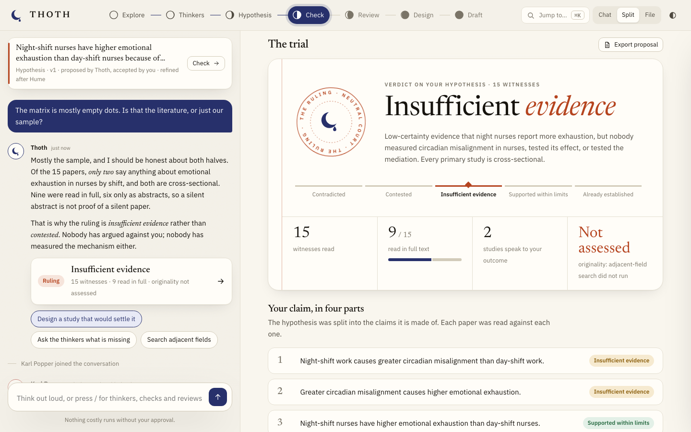 | Split mode: slim pinned hypothesis, chat with ruling twin card, folio with the ruling seal |
| 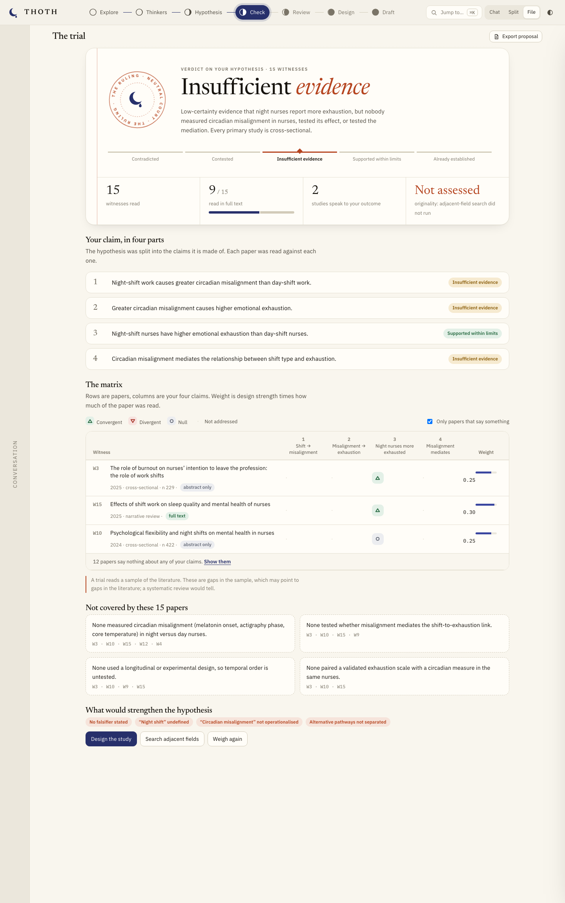 | The whole Check page: ruling, sub-claims, matrix with silence folded, gaps, next actions |
| 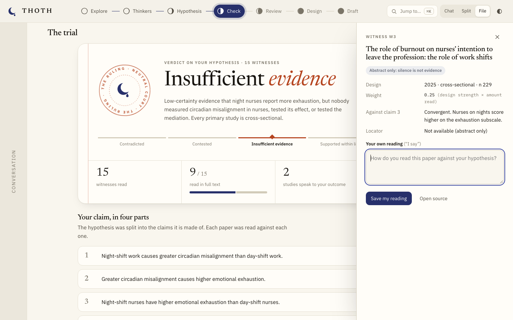 | Witness drawer replacing `window.prompt` |
| 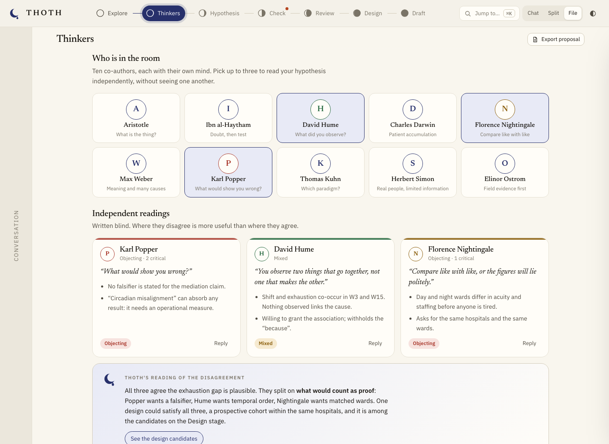 | Roster + three independent readings + Thoth's reading of the disagreement |
| 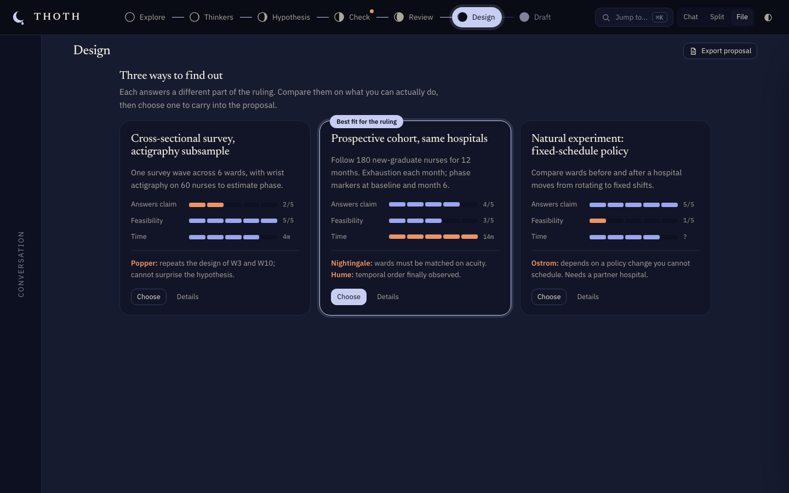 | Design candidates in dark mode, recommended one raised |
| 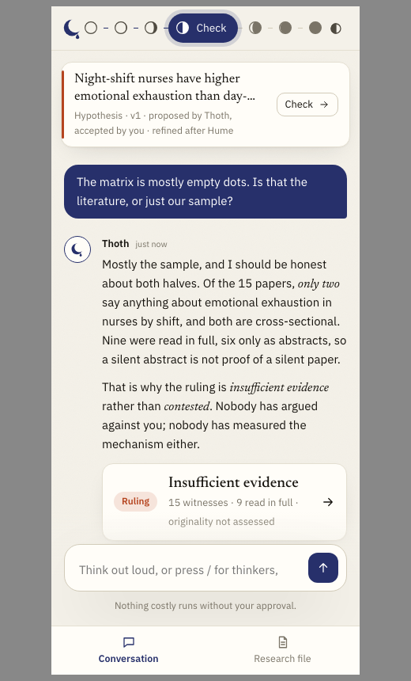 | Phone conversation, bottom tab bar |
| 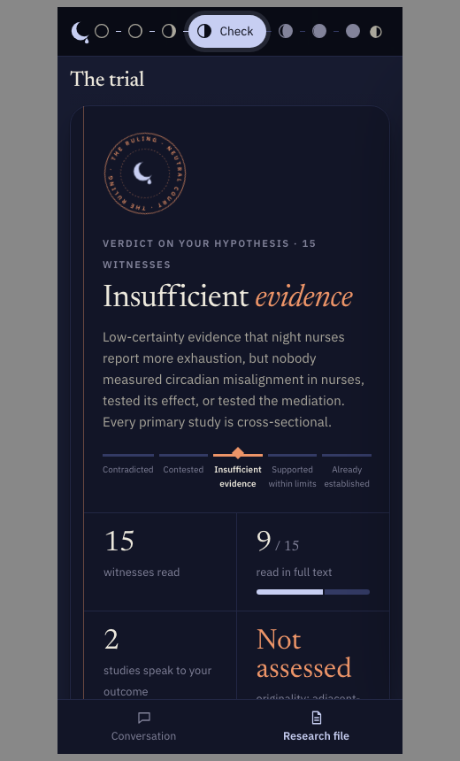 | Phone research file, dark |

Screenshots are headless Chrome renders of the prototype (phone ones through a 390 px iframe). Known prototype shortcuts: static data, no backend, accent colours for thinkers hard-coded in a few places, 36 px icon buttons, unverified contrast pairs (to audit in the build).

## 10. Implementation order (file by file)

Each step is shippable on its own and ends with a user-seat walkthrough per `CLAUDE.md` §8. Do not start while another session is editing the same files. The scenario gate (`make test-vision`) is unaffected: these are frontend changes.

1. **Tokens (`styles/tokens.css`).** Add `--page`, `--page-2`, `--rubric` pairs, `--r`, `--shadow-lg`, thinker identity colours (`--t-popper`, `--t-hume`, …), the darker `--ink-3`. Keep every existing variable name so nothing breaks. Walkthrough: both themes still look right.
2. **Primitives (`styles/components.css`, new `js/ui/sheet.js`, `toast.js`).** `Sheet`, `Toast`, `Tag`, `Meter`, `Scale`, `Drawer`. Replace the three `window.prompt` calls (`chat.js:363`, `design.js:105`, `trial.js:243`). First visible win, lowest risk.
3. **Shell and layout modes (`index.html`, `app.css`, `main.js`, `workspace.js`, `store.js`).** `data-mode` grid, Segmented control, remove the panel tab strip (journey drives `panel`), remember mode, mobile tab bar. Retire `ws-collapsed`/`sb-collapsed` classes in favour of modes (keep the sidebar as the projects rail).
4. **Journey and top bar (`main.js`).** Labelled moons, collapse rules, offer dot, command palette (`js/ui/palette.js`), merge slash menu.
5. **Chat (`chat.js`, `app.css`).** Slim pinned hypothesis, thinker avatars with identity rings, `InlineCard` twins, trace lines, elevated composer.
6. **Check page (`trial.js`).** `Ruling`, sub-claims, matrix rewrite (folded silence, glyph cells, sticky headers), witness drawer, gaps. This is the showpiece; ship it behind the new shell from step 3.
7. **Thinkers page (`thinkers.js`).** Roster, 3-up takes, clash band; debate view reuses the same takes component.
8. **Design page (`design.js`).** Candidate cards, meters, Choose sheet.
9. **Home and empty states (`main.js`, `intro.js` untouched).** Align home with the new tokens; add `Empty` states for unreached stages.
10. **Hypothesis / Draft pages and polish.** Version timeline, proposal sections filling in; motion pass; reduced-motion test; contrast audit; accessibility review; remove dead v1 CSS.

Estimated effort: steps 1–3 (~2 days), 4–5 (~1.5 days), 6 (~2 days), 7–8 (~2 days), 9–10 (~1.5 days).

## 11. Acceptance (user-seat, per `CLAUDE.md` §0)

The revamp is done when someone running the nurses project can, without instruction:
1. Land on the file in Split, see the pinned hypothesis without losing the conversation, and read the **ruling** in under five seconds.
2. Press File, see all four sub-claims and the whole matrix without horizontal scroll, open a witness, write "I say" in a drawer (no browser dialog).
3. See three thinkers disagree side by side and read Thoth's one-paragraph synthesis of *where* they split.
4. Compare three designs on one screen and choose one in a proper sheet.
5. Do all of it by keyboard, in dark mode, at 200% zoom, and on a 375 px phone.
6. Say "that is the best-looking research tool I have used" without being told it is also honest about what it did not read.

## 12. Open questions for the owner

- **Thinker identity colours:** the prototype uses rubric / green / ochre for Popper / Hume / Nightingale. Do you want ten distinct colours, or a restrained two-tone system (indigo and rubric) with monograms only?
- **Seal:** keep the rotating "THE RULING · NEUTRAL COURT" text ring, or a still seal (quieter, more formal)?
- **Sidebar:** the prototype omits the projects sidebar (project switching lives behind the crumb and ⌘K). Keep the full left rail from today's UI?
- **Intro:** leave `intro.js` as is, or give it the new tokens and a one-line hand-off animation into the Split layout?

## 13. Intro and landing page ("The Lantern")

Added 25 Oct 2026 at the owner's request: make the first impression as bold as the app. Prototype: [`docs/design/ui-revamp/landing.html`](../archive/superseded/design/ui-revamp/landing.html)
(self-contained copy with the image inlined: `thoth-landing.html`; `?auto` plays the sample question, `?skipintro` jumps to the page, `?still` renders end states for screenshots).

**Audit of today's intro and home.** The WebGL ink intro is technically impressive but abstract: black screen, a typed line, fluid ink. It does not show *Thoth*, and nothing in it says "research". The home screen is a centred headline and input on a pale glow; it repeats the intro's question and looks like any chat start page. The owner's own 3D renders (`frontend/assets/thoth_bust.jpg`, `thoth_hero.jpg`: black stone ibis with a brass moon-disc crown) are unused in the product. They are the strongest brand asset in the repo.

**Concept: the lantern in the dark gallery.** Thoth is a statue in a dark hall; you hold the only light.

1. **Intro (once per session, ~8 s, skippable, reduced-motion skips it):** darkness; the bust emerges (3 s). Your pointer is a lantern that reveals the stone and the brass. "What's been on your mind?" and a one-line field fade in. Type a real question and press Enter: each letter lifts off the line, drifts up in an arc and **flies into the moon disc on Thoth's crown**; the disc flares; the screen irises open from the disc into the landing page, with your question already in the input. If you do nothing for ~5 s, a sample question types itself. No WebGL needed (the existing fluid shader can stay as an optional layer later).
2. **Hero:** night-indigo sky with a slow starfield; three-line display headline (**Find the question *worth* asking.**, lines rise in); the same input, four "doors" (hunch, hypothesis, reading a paper, surprise me), two honesty promises under it. On the right, the bust in a **brass-edged arch** with a pointer-following lantern, subtle parallax, and the **seven journey moons orbiting the crown**. Brass `#c9a45c` is a hero-only accent taken from the statue; the app keeps indigo and rubric.
3. **"Never" marquee:** a slow ribbon of what Thoth refuses to do (fabricate a citation, pass an abstract off as the paper, ...). Pauses on hover.
4. **How it works:** the page curves from night to paper. A sticky device frame shows three scenes (chat, three thinkers, the ruling seal + mini matrix) that swap as you scroll through three numbered steps.
5. **The journey:** seven labelled moon phases on a line that draws itself.
6. **Ten minds:** thinker cards with identity colours; on hover the card lights up and shows the question that thinker always asks.
7. **The pledge:** five "will never" lines whose red strike-through draws in on scroll, each with the mechanism behind it. This turns the guardrails in `CLAUDE.md` §1 into marketing that is also true.
8. **Final CTA:** crescent glow, "So. What's been on your *mind?*", input.

**Hand-off into the app:** submitting from the intro or landing creates the project with that first message, exactly as `home` does today (`ensureProject` then `say`). The landing becomes `/` for first visits; returning users with projects land in the app, with "Home" in the ⌘K palette.

**Build notes.** Vanilla only: CSS `clip-path: circle()` iris, Web Animations API for the letters, one `<canvas>` starfield (~25 lines), IntersectionObserver for reveals and the sticky story. Image: resize the bust to ~1000 px JPEG (110 KB); no libraries. Reduced motion: intro skipped, no marquee/orbit/starfield animation, reveals instant. Accessibility: the intro is a labelled dialog with Skip and Esc; the headline has an `aria-label` with the plain sentence; all text on night ≥ 4.5:1 (`#dfe3f5` on `#070913`; brass text only at ≥ 18 px or on the dark ground).

**Phases (add after step 9 of §10):** (a) copy the two renders into `frontend/assets/` as optimised JPEGs; (b) split `home` into `landing.js` (new) with the sections above; (c) replace `intro.js` with the lantern intro (keep the old file behind `?intro=ink` until the owner decides); (d) route: first visit and `?landing` show it, otherwise the app.

| Screenshot | Shows |
|---|---|
| 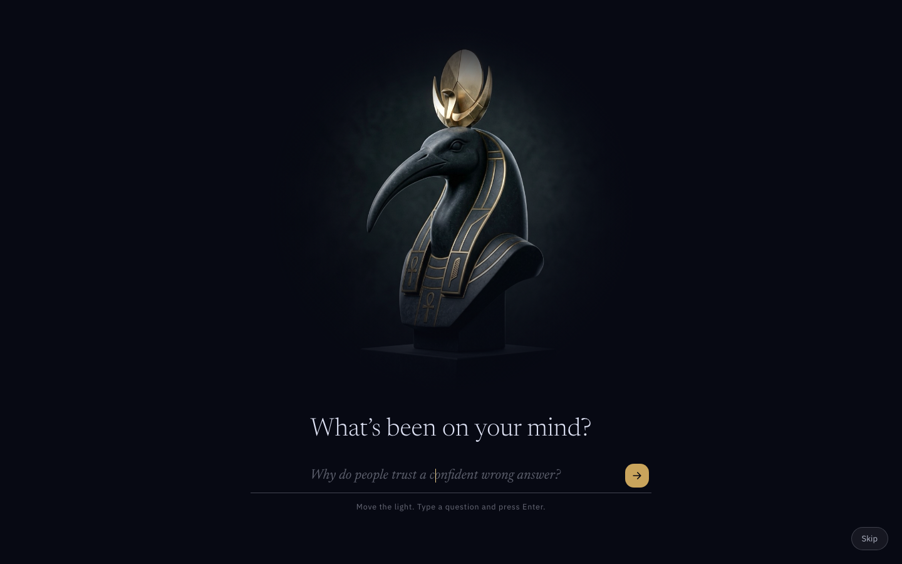 | Intro: the bust in the dark, prompt and field |
| 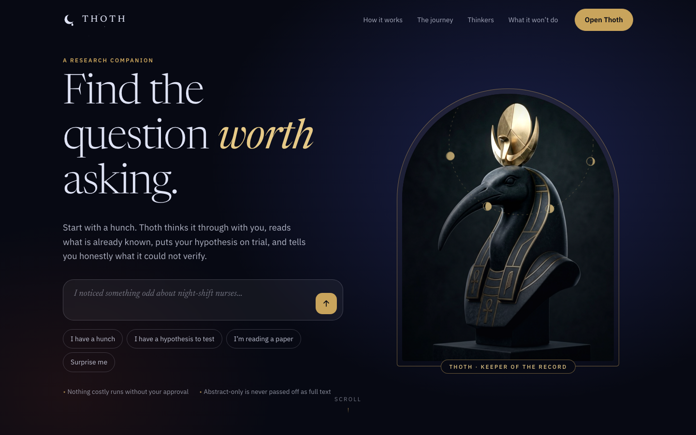 | Landing hero with the arch and orbiting moons |
| 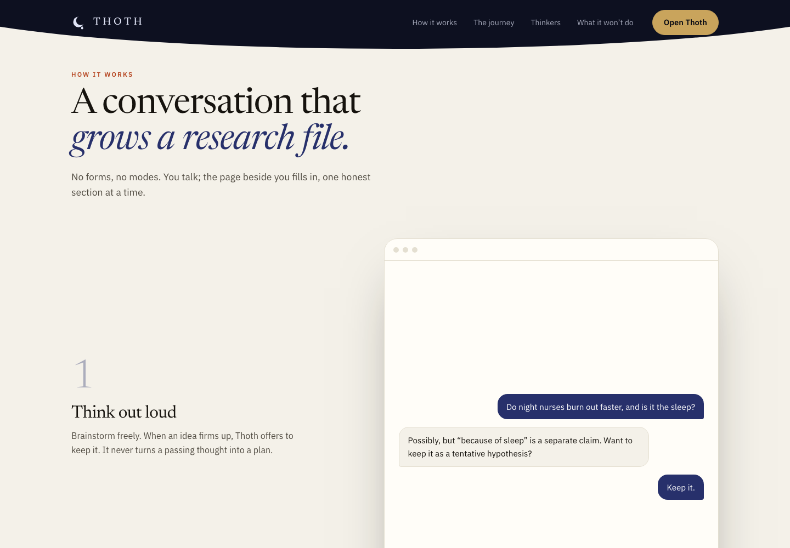 | Night-to-paper transition, sticky "how it works" |
| 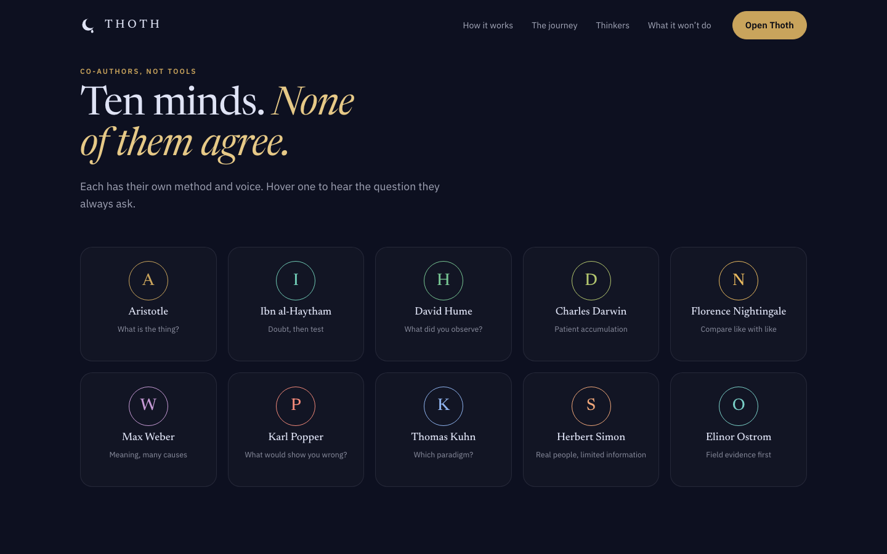 | Ten minds |
| 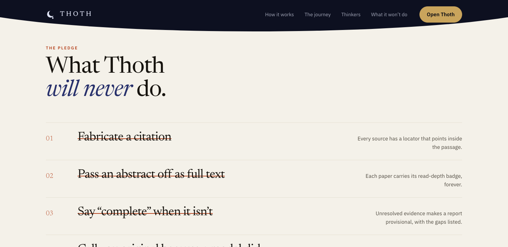 | The pledge |
| 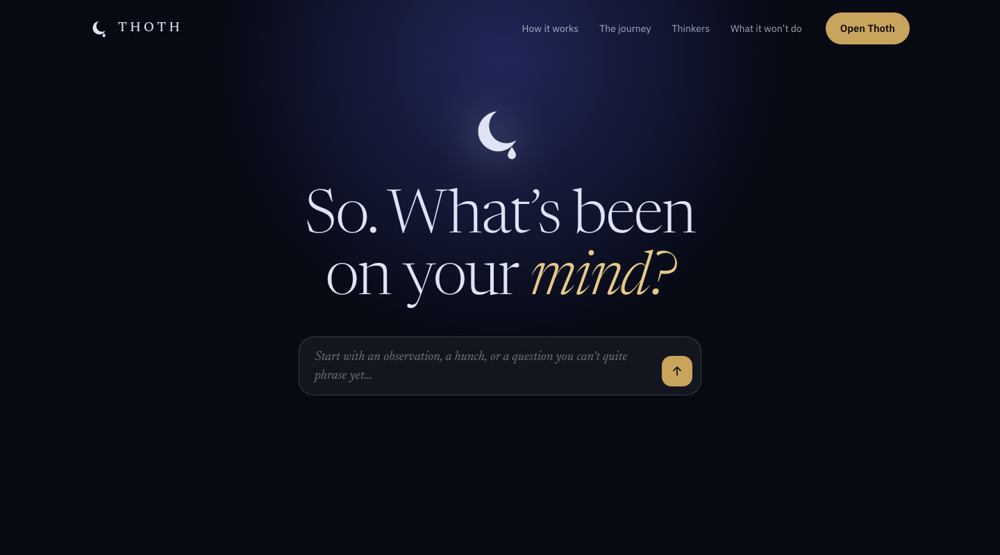 | Closing call to action |

Open questions: keep the fluid-ink shader as an extra layer in the intro? Is brass acceptable as a landing-only accent? Should the landing be public (marketing) as well as the first-run screen?

## 14. Implementation log (real frontend)

Built 25 Oct 2026 in `frontend/` (no backend changes, no behaviour or API changes; every `data-act`, element id and `PANELS`/`cardRenderers` hook is intact). Not committed. Screenshots are real renders of the running app (headless Chrome via CDP, nurses project; the chat column looks empty there only because chat history lives in the owner's browser `localStorage`, while the trial loads from the server).

### Done

| Plan step | What changed | Files |
|---|---|---|
| 1 Tokens | Additive tokens (`--page`, `--page-2`, `--brass`, thinker identity colours). **Contrast fixes:** `--ink-3` light `#8f8a80` to `#6f695e` (5.1:1 on paper; was ~3.2), dark `#6f7080` to `#8f90a6` (6.2:1); `--na` `#767b86` to `#646a76`. Every text pair I checked is now at least 4.5:1 | `styles/tokens.css` |
| 2 Primitives | `askText()` modal dialog (focus trap, Esc, Ctrl/Cmd+Enter, focus restore, labelled) and `toast()`. **All three `window.prompt` calls replaced:** edit proposal (`chat.js`), choose design (`design.js`), "I say" reading (`trial.js`) | new `js/ui.js`, `styles/folio.css` |
| 3 Layout modes | Chat / Split / File segmented control in the top bar (wide screens). File gives the research file about 70% of the width; Split is wider than before (44%). Remembered in `localStorage` (`thoth.layout`). Below 1200 px the existing slide-over workspace and the phone bottom bar are unchanged | `index.html`, `main.js`, `styles/folio.css` |
| 4 Journey | Current stage gets a glow ring; the offer beacon pulses 3 times instead of forever; in File mode non-current stages collapse to moons | `styles/folio.css` |
| 5 Chat | Pinned hypothesis is a slim 2-line card (question, trail and secondary actions appear on click, as on phones before); user bubbles use the accent; composer elevated | `styles/folio.css` |
| 6 Check page | **The ruling:** rotating-text seal with the Ink-moon, display-size verdict with the last word in rubric, 5-step scale, fact strip with read-depth bar, "Not assessed" shown loudly when the adjacent-field search did not run. **Matrix:** shape-plus-colour direction cells, and papers that say nothing about any sub-claim are folded into one line ("12 papers say nothing about any of your claims. Show them") | `trial.js`, `styles/folio.css` |
| 7 Thinkers / 8 Design | Restyled cards (lift on hover, identity-ready), recommended design raised with a glow ring | `styles/folio.css` |
| 9 Home + intro | **Home** is now the lantern hall: night ground in both themes, display headline, the bust in a brass arch with a pointer-following lantern and the seven journey moons orbiting its crown, same input and doors. **Intro "the lantern":** bust emerges in the dark, pointer lights it; typed letters fly into the crown's moon disc, it flares, and the screen opens from the disc into the app with the question asked. The old ink-fluid intro stays as `intro.js` (`?intro=ink`). Asset: `frontend/assets/thoth_bust_1000.jpg` (110 KB) | `main.js` (`renderHome`), new `js/intro-lantern.js`, `styles/folio.css` |

Asset versions bumped to `?v=23/24` in `index.html`. New files: `js/ui.js`, `js/intro-lantern.js`, `styles/folio.css` (loaded after `app.css`, overrides only: fold into `app.css` once the owner signs off).

| Screenshot | Shows |
|---|---|
| 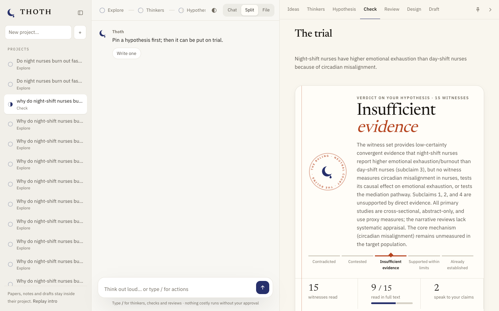 | Split layout, ruling |
| 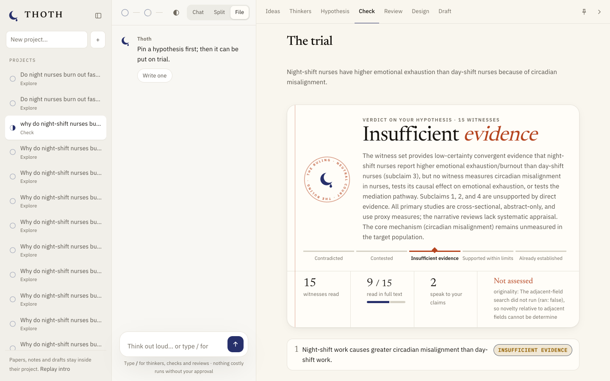 | File layout, ruling in light |
| 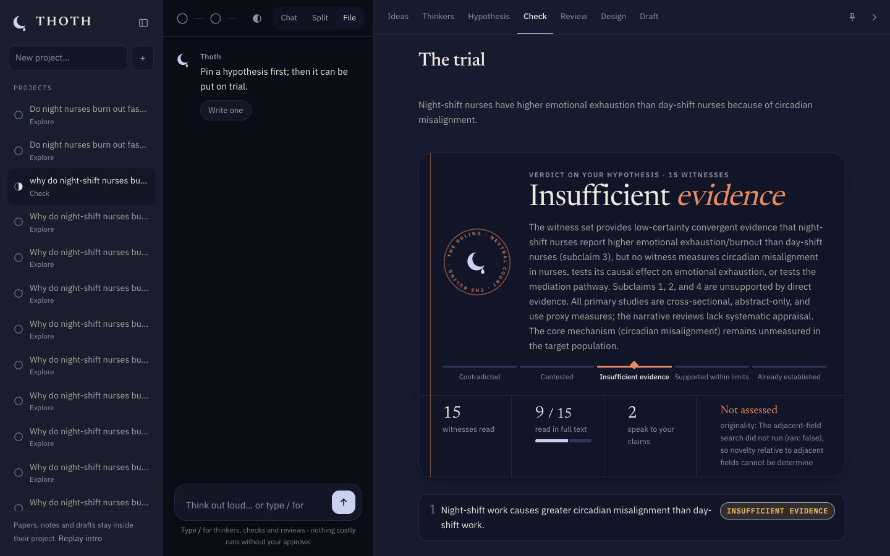 | Same in dark |
| 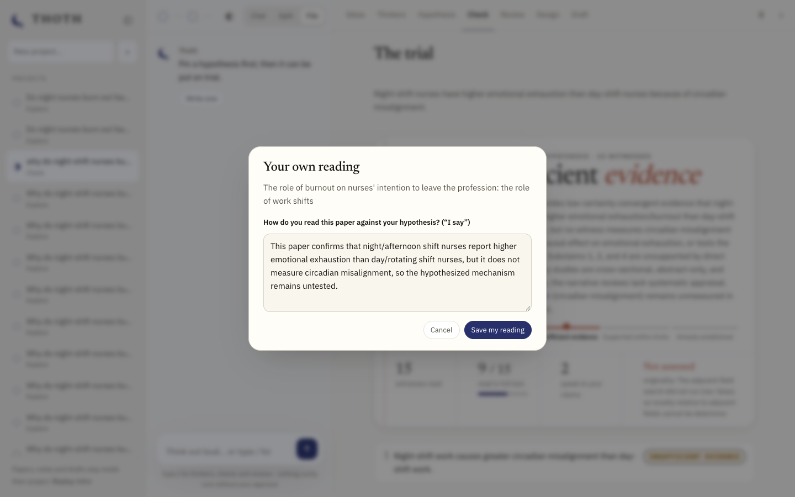 | "Your own reading" dialog (was `window.prompt`) |
| 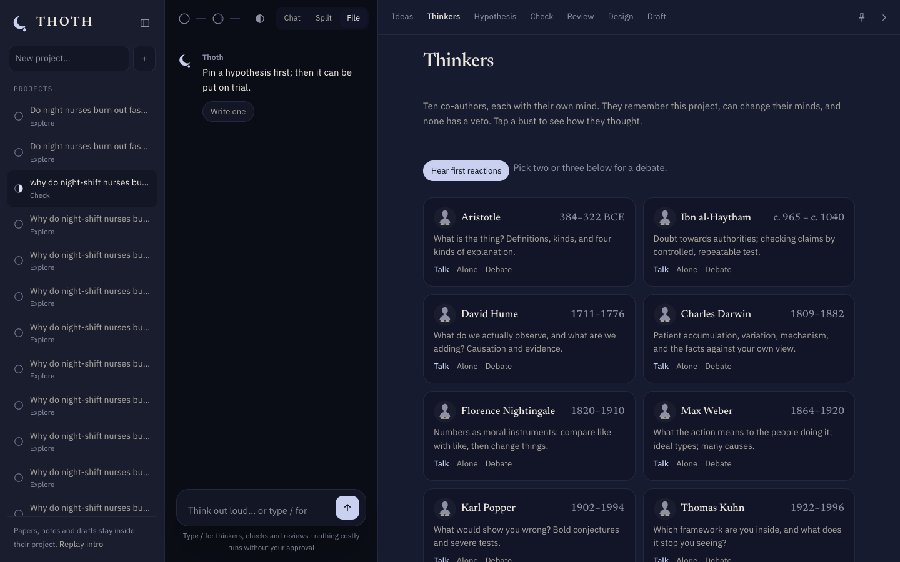 | Thinkers panel, dark |
| 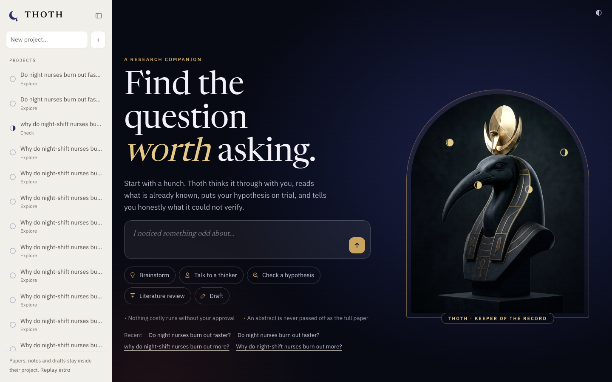 | Home |
| 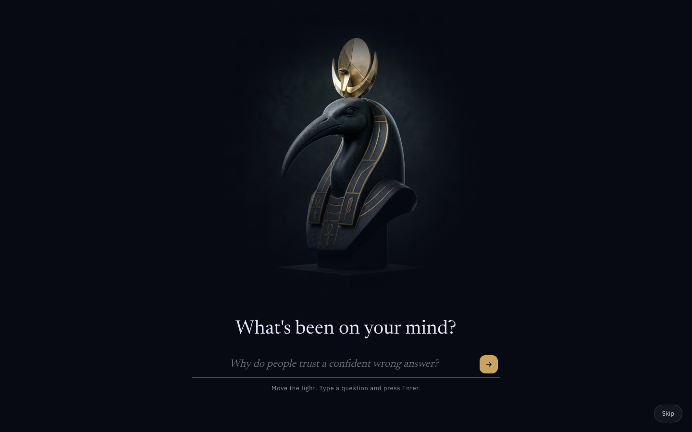 | Intro |
| 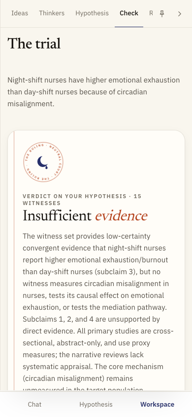 | Phone, ruling |

### Verified
No console errors on load, Check, Thinkers, Home, intro; dialog opens focused, Esc closes it and returns focus; layout seg switches Chat/Split/File; ruling and folded matrix render from a real saved trial (15 witnesses); light and dark; 1440 px, 1024 px and 375 px; reduced-motion rules in place (seal spin, orbit, intro entrances).

### Not done yet (honest list)
- **Command palette (⌘K)**, the toast is built but unused by features so far.
- **Panel tab strip is still there** (restyled only); removing it needs the journey to be the only stage navigation.
- **Thinker debate as three side-by-side takes** with a "Thoth's reading of the disagreement" band, and the roster multi-select: only the card restyle landed. The Design candidates keep their `<details>` layout (recommended one raised), no 5-pip meters yet; those need data fields the backend does not return today (feasibility score, time) and should be mapped from `feasibility`/`blockers`.
- **Matrix is still `<details>` rows**, not a sticky-header table with a drawer; cell shapes and folded silence are in.
- **Thinker identity colours** for chat avatars need `data-thinker` on `.msg.thinker` (CSS ready, markup not added in `chat.js`).
- **Formal accessibility review** not run beyond the contrast table above; keyboard and screen-reader pass of the new dialog and layout control still to do; touch targets in the layout seg are 30 px (fine on desktop, hidden on touch).
- `docs/design/ui-revamp/` prototype is unchanged and remains the reference.
